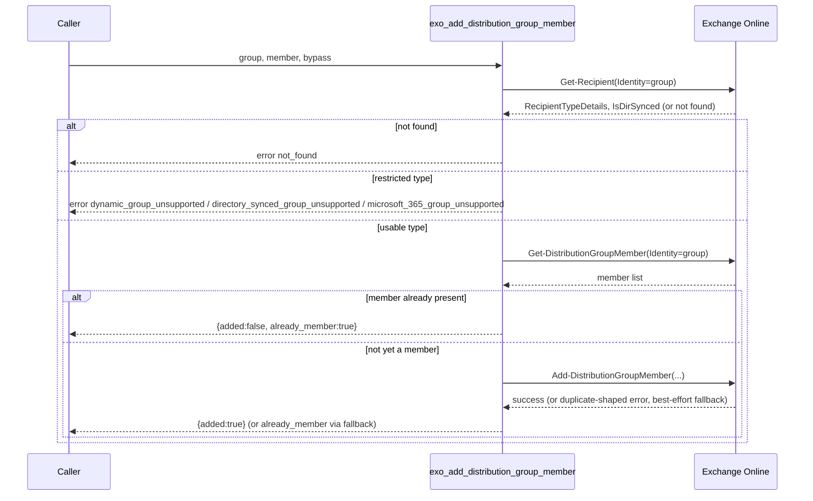
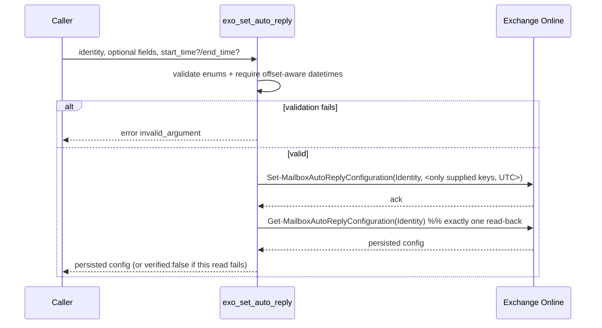

# PRD-20394 · [Feature] Exchange group membership and auto replies

Ticket: https://app.clickup.com/t/86e3pjqdg
Repo: https://github.com/MSPbotsAI/exchange_online_mcp.git@main (d7a85a7)
Work branch: dev01.mbagent/PRD-20394
Status: in progress

## Requirement understanding

One line: Add three Exchange Online APIs — an idempotent distribution-group member-add, and a safe read/write pair for mailbox automatic replies — so Exchange administration can be done by agents without raw PowerShell.

The reporter wants `exo_add_distribution_group_member` to mirror the existing `exo_remove_distribution_group_member` tool's parameter shape, be safe to call repeatedly (report `already_member` instead of erroring), and give a distinct, named error when the target is a group type this tool cannot manage (dynamic distribution group, on-premises-synchronized group, or Microsoft 365 Group). In parallel, the reporter wants `exo_get_auto_reply` / `exo_set_auto_reply` to read and update a mailbox's automatic-reply configuration, requiring any supplied date/time to carry a timezone offset, converting it to UTC before writing, never touching fields the caller did not supply, and reading the configuration back once after a write to confirm what was actually persisted — with the documented Brisbane-local-to-UTC example as a concrete acceptance case. Two related tickets (PRD-20387, PRD-20321) were checked by the reporter beforehand and confirmed not to cover this scope.

## Current state (every claim carries path:line)

- The repository ships 7 tools today across three files: `mailbox.py`, `groups.py`, `devices.py`, registered in `src/exo_mcp/server.py:143-147`.
- `groups.py` has exactly one tool, `exo_remove_distribution_group_member` (`src/exo_mcp/tools/groups.py:16-64`), which calls `Remove-DistributionGroupMember` (`src/exo_mcp/tools/groups.py:53`) with `Identity`, `Member`, `BypassSecurityGroupManagerCheck`, `Confirm: False`. There is **no add-member tool** — grep for `exo_add_distribution_group_member` across `src/` returns zero hits.
- There is **no automatic-reply tool at all**. Grep for `AutoReply` across `src/` returns zero hits; `mailbox.py` only exposes `exo_get_mailbox`, `exo_convert_mailbox_to_shared`, `exo_set_mailbox_hidden`, `exo_set_mailbox_forwarding` (`src/exo_mcp/tools/mailbox.py:94,139,175,216`).
- There is **no group-type classification** anywhere in the repo (no use of `RecipientTypeDetails` or `IsDirSynced` for groups; `RecipientTypeDetails` is only read as a mailbox field, `src/exo_mcp/tools/mailbox.py:22`).
- There is **no datetime-parameter handling** anywhere in the repo. The only existing "don't touch this field" mechanism is the `CLEAR` sentinel (`src/exo_mcp/api_client.py:25-41`), used for `Set-Mailbox -ForwardingAddress $null`-style explicit nulls — it has never been exercised for a date/time value.
- The client's `invoke()` already drops any parameter whose value is `None` (`src/exo_mcp/api_client.py:239-241`, "A parameter set to None is dropped, so a caller can pass optional arguments unconditionally") — this is the exact mechanism needed for the ticket's "preserve unspecified fields" requirement; it already exists and does not need to be built.
- The service-level `instructions` string (`src/exo_mcp/server.py:112-131`) documents an offboarding flow that references `exo_remove_distribution_group_member` but has no equivalent for adding a member or for automatic replies.
- `tests/test_tools.py:17-25` is an outward-contract snapshot (`EXPECTED_TOOLS`) asserting the exact tool set and required parameters; `tests/test_tools.py:41` caps the tool count at `<=20` (currently 7); `tests/test_tools.py:50,52-53` enforce a ≤500-char description, ≤100-char first line, and forbid the literal substring `"API:"` in any tool description — no existing tool's agent-facing docstring names its underlying cmdlet either, so the new tools should follow the same convention even though the ticket text names the cmdlets directly for our benefit.
- wiki: no ProductDocs coverage found for Exchange Online, `exo_mcp`, distribution groups, or automatic replies (`mbp.py wiki find` returned zero hits for all four terms, 2026-10-13). `ProductDocs/18-Dev.md § Published Connectors` (`_verified_ 2026-09-11, v4.1.712`) does cover the general mechanism by which an MCP connector like this one becomes visible to tenants (an admin "Publish Connector" action surfaces it under **MSPbots Connectors** in a tenant's Capabilities) — general platform context, not Exchange-specific.

## Product design

### Goals / Non-goals

**Goals**
- `exo_add_distribution_group_member(group, member, bypass_security_group_manager_check=True)` — adds one named member to a distribution group or mail-enabled security group; idempotent; gives a distinct, named error for each of the three group types it cannot manage.
- `exo_get_auto_reply(identity)` — read-only, returns the mailbox's current automatic-reply configuration.
- `exo_set_auto_reply(identity, ...)` — updates automatic-reply configuration; any field not supplied is left unchanged; any supplied date/time must carry a timezone offset and is converted to UTC before writing; reads the configuration back exactly once after writing and returns the persisted result.

**Non-goals**
- Bulk member add (multiple members per call) — out of scope, mirrors the single-member-per-call shape of the existing removal tool.
- Managing membership of dynamic distribution groups, on-premises-synchronized groups, or Microsoft 365 Groups — these are explicitly rejected with a named error, not supported through a different code path. (Dynamic groups are managed via `Set-DynamicDistributionGroup` rules; on-premises-synced groups must be managed on-premises; Microsoft 365 Groups are owned by Microsoft Graph.)
- Calendar-adjacent out-of-office fields (`CreateOOFEvent`, `DeclineMeetingMessage`, `OOFEventSubject`, `AutoDeclineFutureRequestsWhenOOF`, meeting-decline behavior) — not requested by the ticket; flagged as Open Question in case a future ticket wants them.
- Recurring/annual out-of-office schedules — the underlying cmdlet only supports one start/end window; not expanded here.

### Acceptance criteria AC1..ACn

- **AC1**: Given a distribution group or mail-enabled security group and a recipient not yet a member, when `exo_add_distribution_group_member` is called, then the recipient becomes a member and the response reports `added: true`.
- **AC2**: Given the recipient is already a member of the target group, when `exo_add_distribution_group_member` is called again with the same group+member, then the call does not fail and the response reports `added: false, already_member: true`.
- **AC3**: Given the `group` identifies a dynamic distribution group, when `exo_add_distribution_group_member` is called, then the response is an error explicitly naming "dynamic distribution group" — distinguishable from AC4 and AC5's errors and from a plain not-found error.
- **AC4**: Given the `group` identifies a group synchronized from the on-premises organization, when `exo_add_distribution_group_member` is called, then the response is an error explicitly naming the on-premises-synchronization condition — distinguishable from AC3 and AC5.
- **AC5**: Given the `group` identifies a Microsoft 365 Group, when `exo_add_distribution_group_member` is called, then the response is an error explicitly naming "Microsoft 365 Group" — distinguishable from AC3 and AC4.
- **AC6**: Given `group` or `member` cannot be resolved to any recipient at all, when `exo_add_distribution_group_member` is called, then the response is a plain not-found error, distinct from AC3–AC5.
- **AC7**: Given a mailbox identity, when `exo_get_auto_reply` is called, then the current configuration (state, external audience, internal message, external message, start time, end time) is returned with no side effects.
- **AC8**: Given a mailbox with an existing automatic-reply configuration, when `exo_set_auto_reply` is called supplying only a subset of fields, then every field not supplied keeps its previously configured value — verified by reading the mailbox back afterward.
- **AC9**: Given a supplied `start_time`/`end_time` that carries a timezone offset (e.g. Brisbane, UTC+10), when `exo_set_auto_reply` is called, then the persisted value (verified via the post-write readback) reflects the correctly UTC-converted instant. This must include the documented Brisbane-local-to-UTC example as a concrete case.
- **AC10**: Given a supplied `start_time`/`end_time` with **no** timezone offset, when `exo_set_auto_reply` is called, then the call is rejected with an explicit invalid-argument error — never silently assumed to be UTC or local time.
- **AC11**: Given `exo_set_auto_reply` completes a write, then the tool performs exactly one post-write read of the mailbox and returns the persisted result, not merely an echo of the request.
- **AC12**: Given `identity` cannot be resolved to any mailbox, when `exo_get_auto_reply` or `exo_set_auto_reply` is called, then the response is a not-found error.
- **AC13**: Given an unsupported value for `auto_reply_state` or `external_audience`, when `exo_set_auto_reply` is called, then the response is an invalid-argument error naming the accepted values.
- **AC14 (multi-tenant isolation, non-functional but user-observable)**: Given credentials scoped to tenant A, when any of the three tools is called, then only tenant A's mailbox/group data can ever be read or written — there is no parameter on any tool that can select a different tenant.

### Open questions

- [不阻塞] Should calendar-related auto-reply fields (`CreateOOFEvent`, `OOFEventSubject`, etc.) be added later? Not requested; left out of this design's scope.
- [已假设] The on-premises-synchronized, dynamic-distribution, and Microsoft 365 Group cases are assumed to be classifiable **before** calling the write cmdlet, via a read of the group's recipient type (see Tech design §3 for why). If groom disagrees with doing an extra read per call for this, the tech design would need to change; this does not change any user-visible AC.
- [已假设] "Already a member" is treated as a success outcome (`already_member: true`), never as an error code — if the reporter actually wants it distinguishable as a (soft) error for alerting purposes, AC2's response shape would need a format change; flagged for groom confirmation.

━━━━━━━━━━
TL;DR: Three new Exchange Online tools — idempotent distribution-group member-add with three distinct "unsupported group type" errors, and a read/write pair for mailbox automatic replies with mandatory offset-aware UTC conversion and single post-write readback. No existing tool or behavior changes. Wiki has no Exchange-specific coverage (gap noted); Open Questions are non-blocking.

## Tech design

### Conclusion

Add one new tool to `groups.py` and two new tools to `mailbox.py`, reusing every existing mechanism in the client (`invoke()`'s None-drop semantics, the `ExoError(code=...)` override, the `project()`/field-whitelist pattern) rather than building new infrastructure. The one genuinely new piece of logic is group-type classification: a precondition read via `Get-Recipient` before the write, because relying on `Add-DistributionGroupMember`'s own error text cannot be trusted to distinguish all three restricted group types (see §3). No changes to `server.py`'s credential/auth model, no new files beyond two optional test modules.

### Where the current implementation lives

- `src/exo_mcp/tools/groups.py:16-64` — the only existing group tool (`exo_remove_distribution_group_member`), the shape the new tool must match.
- `src/exo_mcp/tools/mailbox.py:17-33` (`_MAILBOX_FIELDS`), `:55-59` (`_read_mailbox`), `:216-309` (`exo_set_mailbox_forwarding`, the closest existing precedent: read-before, write, read-after with a `verified: false` fallback).
- `src/exo_mcp/api_client.py:25-41` (`CLEAR` sentinel), `:109-141` (`ExoError`, including the `code=` override built for exactly this situation), `:222-254` (`invoke()`, including the None-drop semantics at `:239-241`).
- `src/exo_mcp/tools/_common.py:13-18` (`NO_CREDENTIALS`), `:28-35` (`project()`).
- `src/exo_mcp/tools/devices.py:12,54` — the pagination pattern (`max_page_size`/cap), relevant to the group-membership precheck's read of potentially many members.
- `tests/conftest.py:28-84` (`Upstream`/`cmdlet_errors` mock fixture) and `tests/test_tools.py:17-60` (outward-contract snapshot) — both need extending, not replacing.
- External research (not in this repo, cited as vendor documentation, not wiki/ProductDocs — must be empirically re-confirmed against a real or sandbox tenant before this is trusted in production, see §11):
  - `Get-Recipient` exposes `RecipientTypeDetails` (includes `DynamicDistributionGroup`, `GroupMailbox` for Microsoft 365 Groups, `MailUniversalDistributionGroup`, `MailUniversalSecurityGroup`) and `IsDirSynced` (true for on-premises-synchronized objects). Source: [Get-Recipient (ExchangePowerShell)](https://learn.microsoft.com/en-us/powershell/module/exchangepowershell/get-recipient?view=exchange-ps).
  - An on-premises-synchronized group's write attempt is documented to fail with wording resembling "...because the object is being synchronized from your on-premises organization." Source: [Owners of an on-premises distribution group synced to O365 can't manage the distribution group in Exchange Online](https://learn.microsoft.com/en-US/exchange/troubleshoot/groups-and-distribution-lists/cannot-manage-dg).
  - `Add-DistributionGroupMember` cannot target dynamic distribution groups (membership is rule-computed, not static) or Microsoft 365 Groups (unsupported member/target type for this cmdlet family). No confirmed exact error wording was found for either case, nor for "member already exists" — this absence of a confirmed string is the reason §3 does not rely on error-text parsing for these three. Source: searched via web, no authoritative verbatim string located for these two cases.
  - `Set-MailboxAutoReplyConfiguration`'s `StartTime`/`EndTime` are stored as UTC server-side; the "local time" behavior documented for the interactive PowerShell module is a client-side (session-locale) interpretation layer that does not exist for this server, since it calls the `adminapi/beta` REST endpoint directly (`src/exo_mcp/api_client.py:1-10`) rather than running inside a PowerShell session. Source: [Set Auto-Reply for a Shared Mailbox with PowerShell](https://office365itpros.com/2019/07/29/set-auto-reply-for-a-shared-mailbox/amp/) (documents the UTC-storage / local-display split for the interactive case).

### Option analysis

**Group-type / idempotency classification**

| Option | Approach | Pros | Cost | Verdict |
|---|---|---|---|---|
| A | Precondition `Get-Recipient` read for type classification + `Get-DistributionGroupMember` read for existing-membership check, before any write | Deterministic; fully testable against our own mock without depending on unverified upstream wording; reuses `ExoError(code=...)` cleanly | Two extra reads per call; membership read must page through the whole group for very large groups | **Chosen** |
| B | Call `Add-DistributionGroupMember` directly; classify dynamic/synced/M365/already-member purely from its raw error text | Fewer round-trips | The on-premises-sync wording is documented, but the dynamic-group, Microsoft-365-group, and already-member wordings are **not** confirmed anywhere found — at least two of the four "distinguishable error" requirements (AC2–AC5) would rest on a guess | Rejected |
| C | Precheck group type only (as in A); fall back to error-text parsing for already-member | One fewer read than A | AC2's reliability still rests on unconfirmed wording | Rejected for now; worth revisiting once a real tenant confirms the exact string (noted in Open Questions) |

**Auto-reply tool file placement**

No real alternative: `Get-MailboxAutoReplyConfiguration`/`Set-MailboxAutoReplyConfiguration` take a mailbox `-Identity`, exactly like the existing `Get-Mailbox`/`Set-Mailbox`-based tools. Placed in `mailbox.py` beside `_read_mailbox` rather than a new file, consistent with how every other mailbox-identity-scoped tool already lives there; `devices.py` is a separate file only because it addresses a different Exchange object (device partnerships), not a different cmdlet family on the same object.

### Change list

- `src/exo_mcp/tools/_common.py` **[改]** — add `classify_group_restriction(recipient_type_details: str | None, is_dir_synced: bool) -> tuple[str, str] | None`: a pure function returning `(code, message)` for `DynamicDistributionGroup` / `GroupMailbox` / `is_dir_synced=True`, or `None` if the group type is usable. Pure function, unit-testable with no mock transport.
- `src/exo_mcp/tools/groups.py` **[改]**:
  - Add `_MEMBER_FIELDS` projection dict (`Name`, `PrimarySmtpAddress`, `Alias`, `Guid`) reusing `project()`.
  - Add `exo_add_distribution_group_member(group, member, bypass_security_group_manager_check=True)`:
    1. `Get-Recipient(Identity=group)` → not found → `ExoError(404, ..., code="not_found")`. Otherwise run `classify_group_restriction`; if it returns a restriction, raise `ExoError(400, message, code=that_code, retryable=False)`.
    2. `Get-DistributionGroupMember(Identity=group, max_page_size=200)` (paged, following the `devices.py:54,57` pattern) → case-insensitively match `member` against each candidate's `Name`/`PrimarySmtpAddress`/`Alias`/`Guid`. If matched, return `{"group", "member", "added": false, "already_member": true}` without calling Add.
    3. Otherwise `Add-DistributionGroupMember(Identity=group, Member=member, BypassSecurityGroupManagerCheck=bypass_security_group_manager_check, Confirm=False)` (parameter names identical to the existing removal tool, per the ticket's explicit request) → `{"group", "member", "added": true}`.
    4. Defensive fallback: if step 3 itself raises an `ExoError` whose message plausibly indicates a duplicate-member condition (best-effort substring match, not the primary mechanism — see §7 for the race this covers), return the `already_member` shape instead of propagating the error.
- `src/exo_mcp/tools/mailbox.py` **[改]**:
  - Add `_AUTO_REPLY_FIELDS` projection dict (`AutoReplyState`, `ExternalAudience`, `InternalMessage`, `ExternalMessage`, `StartTime`, `EndTime`).
  - Add `_read_auto_reply(client, identity) -> dict | None` parallel to `_read_mailbox` (`:55-59`), calling `Get-MailboxAutoReplyConfiguration`.
  - Add `_parse_offset_datetime(value: str, field_name: str) -> datetime`: parses with `datetime.fromisoformat` (Python ≥3.12 per `pyproject.toml:5`, native `Z`-suffix support), raises `ExoError(400, ..., code="invalid_argument")` if unparsable or `utcoffset() is None`; converts to UTC.
  - Add `exo_get_auto_reply(identity)`: resolves via `_read_auto_reply`; not found → `ExoError(404, code="not_found")`; projects times as UTC ISO-8601 with a trailing `Z`.
  - Add `exo_set_auto_reply(identity, auto_reply_state=None, external_audience=None, internal_message=None, external_message=None, start_time=None, end_time=None)`: validates `auto_reply_state`/`external_audience` against their enums first (reject before any upstream call, `code="invalid_argument"`); validates/converts `start_time`/`end_time` via `_parse_offset_datetime`; calls `Set-MailboxAutoReplyConfiguration` with only the supplied (non-`None`) keys — relying on the existing `invoke()` None-drop behavior (`api_client.py:239-241`) for "leave unspecified fields alone"; then performs exactly one `_read_auto_reply` and returns the persisted result, or `{"verified": false}` if the read-back itself fails (mirrors `exo_set_mailbox_forwarding`'s existing pattern, `mailbox.py:294-309`).
- `src/exo_mcp/server.py` **[改]** — extend the `instructions` string (`:112-131`) to mention the three new tools in the existing offboarding/administration narrative.
- `README.md` **[改]** — add 3 rows to the Tools table; add `dynamic_group_unsupported`, `directory_synced_group_unsupported`, `microsoft_365_group_unsupported` to the Errors section's code vocabulary; update the "7 tools" / tool-count references in the Delivery checklist's Agent-facing design section.
- `tests/test_tools.py` **[改]** — extend `EXPECTED_TOOLS` (`:17-25`) and the `_READ_ONLY`/`_DESTRUCTIVE` sets (`:27-32`) with the three new tools (`exo_get_auto_reply` read-only; the other two neither purely read-only nor strictly destructive in the existing taxonomy — needs a judgment call during implementation, flagged here rather than guessed).
- `tests/test_groups_add_member.py`, `tests/test_mailbox_auto_reply.py` **[新增]** — new test modules following the `Upstream`/`cmdlet_errors` fixture pattern (`tests/conftest.py:28-84`): one test per AC (happy path, already-member, each of the three restricted-type errors, not-found, partial-update preservation, Brisbane UTC conversion, missing-offset rejection, read-back-fails-after-write-succeeds).
- `tests/mock_e2e/run_e2e.py` **[改]** — extend the real-container `tools/list`/`tools/call` smoke drive from 7 to 10 tools (README states it currently "drives 401 → initialize → tools/list → tools/call for all seven tools").

Not found in the repo: any existing datetime-parameter handling, or any existing group-type classification — both confirmed as new ground by the greps in "Current state" above; no path exists to extend instead of build.

### Data & API contract

**`exo_add_distribution_group_member(group: str, member: str, bypass_security_group_manager_check: bool = True) -> str`**

Success (new member):
```json
{"group": "sales@contoso.com", "member": "alice@contoso.com", "added": true}
```
Success (idempotent repeat):
```json
{"group": "sales@contoso.com", "member": "alice@contoso.com", "added": false, "already_member": true}
```
Errors (all via `ExoError(...).to_envelope()`):
```json
{"error": {"code": "not_found", "message": "No recipient found for 'sales@contoso.com'", "retryable": false}}
{"error": {"code": "dynamic_group_unsupported", "message": "'sales@contoso.com' is a dynamic distribution group; membership is computed from rules (Set-DynamicDistributionGroup), not static membership — this tool cannot add members to it", "retryable": false}}
{"error": {"code": "directory_synced_group_unsupported", "message": "'sales@contoso.com' is synchronized from the on-premises directory; manage its membership on-premises — changes sync to Exchange Online automatically", "retryable": false}}
{"error": {"code": "microsoft_365_group_unsupported", "message": "'sales@contoso.com' is a Microsoft 365 Group; its membership is owned by Microsoft Graph, not Exchange — use a Graph MCP server to manage it", "retryable": false}}
```

**`exo_get_auto_reply(identity: str) -> str`**

Success:
```json
{"identity": "alice@contoso.com", "auto_reply_state": "Scheduled", "external_audience": "Known", "internal_message": "...", "external_message": "...", "start_time": "2026-01-09T23:00:00Z", "end_time": "2026-01-16T23:00:00Z"}
```
Fields absent from the upstream response are omitted (consistent with `project()`'s existing drop-absent behavior, `_common.py:28-35`), not rendered as `null`.

**`exo_set_auto_reply(identity: str, auto_reply_state: str | None = None, external_audience: str | None = None, internal_message: str | None = None, external_message: str | None = None, start_time: str | None = None, end_time: str | None = None) -> str`**

- `auto_reply_state` accepted values: `Disabled`, `Enabled`, `Scheduled`.
- `external_audience` accepted values: `None`, `Known`, `All`.
- `start_time`/`end_time`: ISO-8601 with a timezone offset, e.g. `2026-01-10T09:00:00+10:00` (Brisbane). Converted to UTC before being sent upstream.
- Any parameter left as `None` is not sent to `Set-MailboxAutoReplyConfiguration` at all (preserves the existing value). To explicitly clear `internal_message`/`external_message`, pass `""` (empty string is not `None`, so it is sent through — mirrors the documented `-InternalMessage ""` convention).
- Success: the post-write read-back, same shape as `exo_get_auto_reply`'s success response, or `{"identity": ..., "write_succeeded": true, "verified": false}` if the write succeeded but the read-back itself failed (mirrors `exo_set_mailbox_forwarding`'s `verified: false` convention, `mailbox.py:171,212,301`).
- Validation errors (`code: "invalid_argument"`) for: an unsupported `auto_reply_state`/`external_audience` value (message lists the accepted values); a `start_time`/`end_time` with no timezone offset or that fails to parse.
- Not-found (`code: "not_found"`) if `identity` does not resolve to any mailbox.

**DB**: none — this server has no persistent storage; all state lives in Exchange Online.

**Backward compatibility**: purely additive. The 7 existing tools' signatures, error codes, and response shapes are unchanged.

### Key flow / sequence





### Non-functional

- **幂等/并发 (idempotency & concurrency)**: `exo_add_distribution_group_member` is idempotent by construction via the existing-membership precheck (AC2). There is a TOCTOU race under concurrent callers adding the same member: both could pass the "not a member yet" check before either writes. The defensive fallback in the change list (catching a plausibly-duplicate error from the write itself) is a best-effort safety net for this race, not the primary mechanism — it is not guaranteed to match real Exchange wording (see §2's research notes), so a race that hits an unrecognized error string will surface as `upstream_error` rather than `already_member`. Acceptable: the race window is the gap between two reads and a write within one process's request handling, not a sustained hot path.
- **性能 (performance)**: the existing-membership precheck enumerates the group's full membership (`Get-DistributionGroupMember`, paged per `devices.py:54,57`'s pattern). For very large groups (thousands of members) this is the dominant cost of every call, including the common case of adding a genuinely new member. Acceptable for an admin/automation tool, not a high-QPS path; flagged as a risk in §11 rather than engineered around, since no cursoring mechanism exists elsewhere in this client to build on.
- **安全 (security)**: no change to the credential or authorization model — both new tools go through the same per-request `ExoClient` from the context-scoped credentials (`server.py:37-42`). No new sensitive data is surfaced beyond what `Get-MailboxAutoReplyConfiguration`/`Get-Recipient` already expose to anyone with the existing Exchange role assignment; error messages are capped to the same conventions as `_error_message` (`api_client.py:350-377`, max 500 chars, no raw body echo).
- **多租户隔离 (multi-tenant isolation)**: unchanged — enforced structurally by `GatewayCredentialMiddleware`'s per-request contextvar (`server.py:28-105`), not by any application-level tenant filter. No parameter on either new tool can select a tenant other than the one whose credentials arrived with the request (AC14).
- **可观测 (observability)**: no logging framework exists in this repo today beyond the structured error envelope; this change does not add one, consistent with the existing level — not a regression introduced by this feature. If audit logging of group-membership changes is wanted, that is a larger, separate concern outside this ticket's scope (noted as Open Question candidate for a future ticket, not blocking here).

### Rollout & rollback

No feature-flag mechanism exists in this repo (single versioned container image, `README.md`'s "Run it" section). Rollout: merge → rebuild image → redeploy → re-publish via the admin "Publish Connector" flow (`wiki: ProductDocs/18-Dev.md § Published Connectors`, `_verified_ 2026-09-11`). All three new tools are purely additive — no existing tool's signature, error vocabulary, or response shape changes — so rollback is a plain revert-and-redeploy with no data migration concern (this server holds no persistent state of its own). One caveat inherent to MCP, not specific to this change: agents that already cached the 7-tool list from a prior session will not see the 3 new tools until they reconnect / refresh their tool list.

### Test strategy

Unit tests only (no network), following `tests/conftest.py:28-84`'s `Upstream`/`cmdlet_errors` mock-transport fixture, one test per AC:

- AC1/AC6 happy path and not-found for `exo_add_distribution_group_member`.
- AC2 idempotent repeat (membership list contains the member).
- AC3/AC4/AC5 each restricted group type, driven by mocked `Get-Recipient` responses (`RecipientTypeDetails`/`IsDirSynced` combinations) — this is exactly why §3 chose the precheck design: these three tests do not depend on any unconfirmed real-tenant error wording.
- AC7/AC12 happy path and not-found for `exo_get_auto_reply`.
- AC8 partial-update preservation: mock `Get-MailboxAutoReplyConfiguration` to return a full existing config, call `exo_set_auto_reply` with one field, assert the `Set-MailboxAutoReplyConfiguration` request captured by the fixture's `invoke_requests` (`conftest.py:64-71`) contains only the supplied key.
- AC9 Brisbane-local → UTC conversion (the ticket's documented example) as an explicit named test.
- AC10/AC13 rejection of a naive datetime and of an invalid enum value, asserted to happen **before** any `invoke_requests` entry is recorded (i.e. no upstream call at all).
- AC11 single-read-back assertion: count `invoke_requests` entries for `Get-MailboxAutoReplyConfiguration` equals exactly 1 per `exo_set_auto_reply` call.
- Read-back-fails-after-write-succeeds path (`verified: false`), mirroring the existing test for `exo_set_mailbox_forwarding`'s equivalent branch.
- `tests/test_tools.py`'s `EXPECTED_TOOLS` snapshot extended to assert the outward contract for all 3 new tools (name, required params, description length/format, `"API:"` absence, annotations).
- `tests/mock_e2e/run_e2e.py` extended from 7 to 10 tools in its real-container smoke drive.

**Regression surface**: none expected on the 7 existing tools — all changes are additive to `groups.py`, `mailbox.py`, and `_common.py`; no existing function signature changes.

**Must be hand-verified against a real or sandbox tenant before this is trusted in production** (cannot be confirmed by unit tests alone, see §11): the exact wire format the `adminapi/beta` endpoint accepts for a DateTime cmdlet parameter, and whether `Set-MailboxAutoReplyConfiguration`'s `StartTime`/`EndTime` are indeed stored as UTC when called through this REST path (§2 cites supporting documentation for the interactive-PowerShell case, but this server bypasses that layer entirely, so it is an inference, not a confirmed fact about this specific code path).

### Effort & breakdown

- `exo_add_distribution_group_member` (classifier + idempotency precheck + fallback + tests): 1.5–2.5 person-days — genuinely new logic (two upstream reads, three new error codes, race handling).
- `exo_get_auto_reply` + `exo_set_auto_reply` (timezone parsing/validation + partial-update + read-back + tests): 2–3 person-days — datetime handling is new ground in this repo; the real-tenant verification step (§9) adds uncertainty.
- README / `mock_e2e` / Delivery-checklist updates: 0.5 person-day.
- **Total: ~4–6 person-days.**

Suggested subtasks, each independently verifiable:
1. `exo_add_distribution_group_member` (classifier, precheck, tool, tests).
2. `exo_get_auto_reply` + `exo_set_auto_reply` (can land together — they share the read helper and field projection).
3. Docs/mock_e2e/README/Delivery-checklist updates.

### Risks & dependencies

1. The DateTime wire format for `InvokeCommand` parameters is unconfirmed empirically — no existing tool in this repo sends a datetime parameter. Chosen format: ISO-8601 UTC with trailing `Z`. Must be validated against a sandbox tenant before merge; if rejected, a fallback format may be needed.
2. The exact "already a member" error wording from `Add-DistributionGroupMember` is not confirmed by any source found — the chosen design (existing-membership precheck) avoids depending on it for the primary path; see §7 for the one place (a concurrency race) where the unconfirmed wording could still surface.
3. The existing-membership precheck enumerates the full group membership list; acceptable for this tool's admin-automation use case, but worth noting for very large groups (§7).
4. Exercising AC4 (on-premises-synchronized group) against a *real* tenant requires a hybrid Entra Connect setup, which may not exist in whatever test tenant is available — soft risk, not a hard blocker: the classification logic itself is unit-testable against a mocked `IsDirSynced: true` response regardless.
5. Duplicate-scope risk already resolved: the reporter pre-checked PRD-20387 (EXO mailbox-permission tools) and PRD-20321 (Graph/ConnectWise/EXO connector gaps) and confirmed via ClickUp comment that neither covers these three APIs.

━━━━━━━━━━
TL;DR: New ground is the group-type classifier (precondition `Get-Recipient` read, chosen over unverified error-text parsing) and offset-aware UTC datetime handling (new to this repo). Everything else — None-drop for partial updates, read-after-write verification, `ExoError(code=...)` — already exists and is reused as-is. Biggest open risk is empirical: the DateTime wire format and the UTC-storage assumption both need a sandbox-tenant check before trusting them in production.

## Test cases

Full steps, preconditions, and automated test references live in the sibling `docs/tickets/PRD-20394.ac.json`. Pass/fail statements only, grouped by AC:

- **TC-EXO-001** (AC1, auto): Given group `g1` with member not present, adding `m1` returns `added:true`, and a subsequent membership read includes `m1`.
- **TC-EXO-002** (AC2, auto): Given `m1` already a member of `g1`, calling add again returns `added:false, already_member:true` and issues no `Add-DistributionGroupMember` call.
- **TC-EXO-003** (AC3, auto): Given `group` resolves to `RecipientTypeDetails=DynamicDistributionGroup`, add returns `error.code=dynamic_group_unsupported` mentioning "dynamic distribution group".
- **TC-EXO-004** (AC4, auto): Given `group` resolves with `IsDirSynced=true`, add returns `error.code=directory_synced_group_unsupported` mentioning on-premises synchronization.
- **TC-EXO-005** (AC5, auto): Given `group` resolves to `RecipientTypeDetails=GroupMailbox`, add returns `error.code=microsoft_365_group_unsupported` mentioning "Microsoft 365 Group".
- **TC-EXO-006** (AC3/4/5, auto): The three error codes in TC-EXO-003/004/005 are pairwise distinct strings.
- **TC-EXO-007** (AC6, auto): Given `group` resolves to nothing, add returns `error.code=not_found`.
- **TC-EXO-008** (AC6, auto): Given `member` resolves to nothing (group exists and is usable), add returns `error.code=not_found`.
- **TC-EXO-009** (AC7, auto): `exo_get_auto_reply` on a mailbox with a scheduled auto-reply returns state/audience/messages/start/end matching the mocked upstream record, and issues no write call.
- **TC-EXO-010** (AC8, auto): Given an existing config with `external_audience=Known` and a non-empty `external_message`, calling `exo_set_auto_reply` with only `internal_message` supplied results in an upstream `Set-MailboxAutoReplyConfiguration` call containing only `InternalMessage`, and the post-write read-back still shows the original `external_audience`/`external_message`.
- **TC-EXO-011** (AC9, auto — Brisbane example): `start_time="2026-01-10T09:00:00+10:00"` is sent upstream as `"2026-01-09T23:00:00Z"`.
- **TC-EXO-012** (AC10, auto): `start_time="2026-01-10T09:00:00"` (no offset) is rejected with `error.code=invalid_argument`, with zero upstream `Set-*`/`Get-*` calls recorded.
- **TC-EXO-013** (AC11, auto): After a successful `exo_set_auto_reply` call, exactly one `Get-MailboxAutoReplyConfiguration` invocation is recorded.
- **TC-EXO-014** (AC11, auto): If the post-write read fails (mocked upstream error on `Get-MailboxAutoReplyConfiguration` only), the write is still reported as succeeded, with `verified:false` and no exception raised.
- **TC-EXO-015** (AC12, auto): `exo_get_auto_reply`/`exo_set_auto_reply` on an unresolvable `identity` both return `error.code=not_found`.
- **TC-EXO-016** (AC13, auto): `auto_reply_state="Maybe"` (not an accepted value) is rejected with `error.code=invalid_argument` naming the accepted values, before any upstream call.
- **TC-EXO-017** (AC14, manual — security/isolation, OWASP API1 BOLA-anchored): [需求缺失/INCOMPLETE] the repo's tenant isolation is structural (contextvar-scoped credentials, no tenant parameter on any tool), so this is a **design-review** case rather than a runtime test: confirm during code review that neither new tool accepts or forwards any tenant-selecting parameter, and that both go through `client_factory()` (`server.py:140-141`) exactly like the 7 existing tools. A true cross-tenant runtime test would require two real tenants' credentials, which this repo's test suite does not have (no real tenant in CI, per `README.md`'s Tests section).

### Uncovered ACs

None — every AC above has at least one test case. TC-EXO-017 is marked incomplete because it is a design-review check standing in for a runtime test that needs infrastructure (two real tenants) this repository's test suite does not have.

Test case generation note: `Skill(testcase-generation-employees)` was not mounted in this session (unattended tick, no dialogue available to request it); test cases above were produced directly against this pipeline's own documented `ac.json` schema and quality bar (`references/testcase.md`) instead. No performance test case is included — these are MCP tool calls proxying single Exchange Online cmdlet invocations with no batching/pagination design beyond what devices.py already established; there is no meaningful load profile to design a performance case against without inventing one, so it is skipped rather than fabricated.
