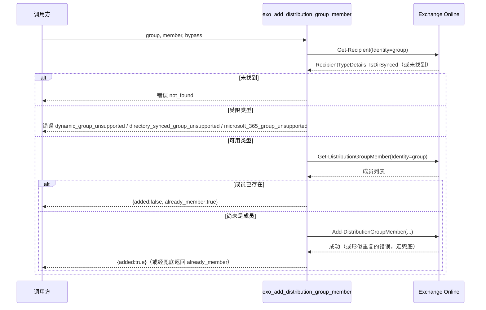
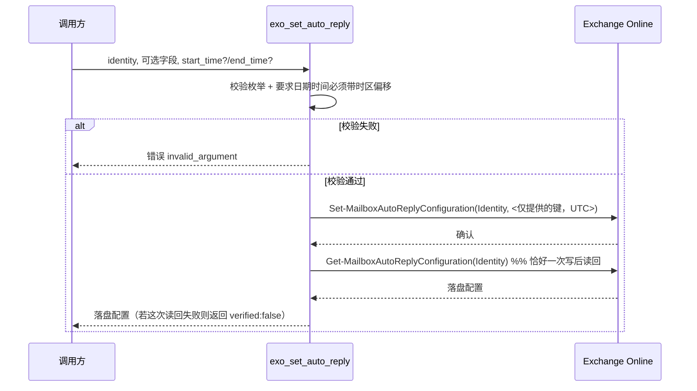

# PRD-20394 · [Feature] Exchange group membership and auto replies

工单: https://app.clickup.com/t/86e3pjqdg
仓库: https://github.com/MSPbotsAI/exchange_online_mcp.git@main (d7a85a7)
工作分支: dev01.mbagent/PRD-20394
状态: 冻结 @ ce2caf4

## 需求理解

一句话：新增三个 Exchange Online API——一个幂等的分发组成员添加接口，以及一对安全的邮箱自动回复读/写接口——让 agent 不用原生 PowerShell 就能做 Exchange 管理。

提单人希望 `exo_add_distribution_group_member` 的参数形状与现有的 `exo_remove_distribution_group_member` 保持一致，可以安全地重复调用（已是成员时返回 `already_member` 而不是报错），并且在目标是本工具管不了的组类型（动态分发组、本地同步组、Microsoft 365 群组）时给出可区分的、明确命名的错误。与此同时，提单人希望 `exo_get_auto_reply` / `exo_set_auto_reply` 能读写邮箱的自动回复配置，要求任何传入的日期/时间都必须带时区偏移、写入前转换成 UTC、绝不触碰调用方没有提供的字段，并且在写入后读回一次配置以确认实际落盘的内容——并把文档里那个 Brisbane 本地时间转 UTC 的例子作为一条具体的验收用例。提单人事先核对过两张相关工单（PRD-20387、PRD-20321），并已在工单上确认这两张单都不覆盖本单范围。

## 现状（每条陈述都带 path:line）

- 该仓库目前共 7 个工具，分布在三个文件：`mailbox.py`、`groups.py`、`devices.py`，注册于 `src/exo_mcp/server.py:143-147`。
- `groups.py` 目前只有一个工具 `exo_remove_distribution_group_member`（`src/exo_mcp/tools/groups.py:16-64`），调用 `Remove-DistributionGroupMember`（`src/exo_mcp/tools/groups.py:53`），参数为 `Identity`、`Member`、`BypassSecurityGroupManagerCheck`、`Confirm: False`。**没有任何添加成员的工具**——在 `src/` 下搜 `exo_add_distribution_group_member` 零命中。
- **完全没有自动回复相关工具**。在 `src/` 下搜 `AutoReply` 零命中；`mailbox.py` 只暴露了 `exo_get_mailbox`、`exo_convert_mailbox_to_shared`、`exo_set_mailbox_hidden`、`exo_set_mailbox_forwarding`（`src/exo_mcp/tools/mailbox.py:94,139,175,216`）。
- 仓库里**没有任何组类型判定逻辑**（没有任何地方用到组的 `RecipientTypeDetails` 或 `IsDirSynced`；`RecipientTypeDetails` 目前只作为邮箱字段被读取，`src/exo_mcp/tools/mailbox.py:22`）。
- 仓库里**没有任何日期时间参数处理逻辑**。现有唯一的「不要动这个字段」机制是 `CLEAR` 哨兵（`src/exo_mcp/api_client.py:25-41`），用于 `Set-Mailbox -ForwardingAddress $null` 这类显式置空，从未用于日期时间值。
- 客户端的 `invoke()` 已经会丢弃值为 `None` 的参数（`src/exo_mcp/api_client.py:239-241`，原注释："A parameter set to None is dropped, so a caller can pass optional arguments unconditionally"）——这正是本单「未提供的字段保持不变」所需要的机制，**已经存在，不需要新建**。
- 服务级 `instructions` 字符串（`src/exo_mcp/server.py:112-131`）里记录的离职流程提到了 `exo_remove_distribution_group_member`，但没有添加成员、也没有自动回复的对应说明。
- `tests/test_tools.py:17-25` 是一份对外契约快照（`EXPECTED_TOOLS`），断言完整工具集与必填参数；`tests/test_tools.py:41` 限定工具数量 `<=20`（当前 7 个）；`tests/test_tools.py:50,52-53` 强制描述 ≤500 字符、首行 ≤100 字符，并禁止描述里出现字面量 `"API:"`——现有工具的 agent 可见 docstring 都没有提到底层 cmdlet 名称，即便工单原文直接点名了 cmdlet（那是为了方便我们实现，不代表要写进面向 agent 的描述），新工具也应遵循同一惯例。
- wiki：`mbp.py wiki find` 对 Exchange Online、`exo_mcp`、distribution group、auto reply 四个关键词均零命中（2026-10-13 实测），产品事实库未覆盖本单涉及的具体行为。`ProductDocs/18-Dev.md § Published Connectors`（`_verified_ 2026-09-11, v4.1.712`）记录了此类 MCP 连接器如何对租户可见的通用机制（管理员执行 "Publish Connector" 后出现在租户 Capabilities 的 **MSPbots Connectors** 下）——这是通用平台背景信息，不是 Exchange 专属事实。

## 产品设计

### 目标 / 非目标

**目标**
- `exo_add_distribution_group_member(group, member, bypass_security_group_manager_check=True)`——向一个分发组或邮件启用的安全组添加一名指定成员；幂等；对三种本工具管不了的组类型分别给出可区分、命名明确的错误。
- `exo_get_auto_reply(identity)`——只读，返回邮箱当前的自动回复配置。
- `exo_set_auto_reply(identity, ...)`——更新自动回复配置；未提供的字段保持不变；提供的日期/时间必须带时区偏移，写入前转换为 UTC；写入后仅读回一次配置并返回落盘结果。

**非目标**
- 批量添加成员（一次调用多个成员）——不在范围内，与现有删除工具「一次一个成员」的形状保持一致。
- 管理动态分发组、本地同步组、Microsoft 365 群组的成员——这三类会被显式拒绝并给出命名错误，而不是走别的代码路径支持。（动态组的成员由 `Set-DynamicDistributionGroup` 规则计算；本地同步组必须在本地管理；Microsoft 365 群组由 Microsoft Graph 拥有。）
- 日历相关的外出字段（`CreateOOFEvent`、`DeclineMeetingMessage`、`OOFEventSubject`、`AutoDeclineFutureRequestsWhenOOF` 等会议拒绝行为）——工单未要求，列入 Open Questions 供后续工单考虑。
- 重复性/按年的外出排程——底层 cmdlet 本身只支持一个起止时间窗口，本次不扩展。

### 验收标准 AC1..ACn

- **AC1**：给定一个分发组或邮件启用的安全组、以及一个尚未加入的收件人，当调用 `exo_add_distribution_group_member` 时，该收件人成为成员且响应报告 `added: true`。
- **AC2**：给定该收件人已是目标组成员，当用同样的 group+member 再次调用 `exo_add_distribution_group_member` 时，调用不失败，响应报告 `added: false, already_member: true`。
- **AC3**：给定 `group` 指向一个动态分发组，当调用 `exo_add_distribution_group_member` 时，响应是一个明确提到"dynamic distribution group"的错误——必须与 AC4、AC5 的错误、以及普通的未找到错误都能区分开。
- **AC4**：给定 `group` 指向一个从本地组织同步过来的组，当调用 `exo_add_distribution_group_member` 时，响应是一个明确提到本地同步状态的错误——必须与 AC3、AC5 可区分。
- **AC5**：给定 `group` 指向一个 Microsoft 365 群组，当调用 `exo_add_distribution_group_member` 时，响应是一个明确提到"Microsoft 365 Group"的错误——必须与 AC3、AC4 可区分。
- **AC6**：给定 `group` 或 `member` 根本解析不出任何收件人，当调用 `exo_add_distribution_group_member` 时，响应是普通的未找到错误，与 AC3–AC5 不同。
- **AC7**：给定一个邮箱 identity，当调用 `exo_get_auto_reply` 时，返回当前配置（状态、外部受众、内部消息、外部消息、起止时间），且无任何副作用。
- **AC8**：给定一个已有自动回复配置的邮箱，当调用 `exo_set_auto_reply` 且只提供部分字段时，所有未提供的字段都保留原值——通过之后读回邮箱来验证。
- **AC9**：给定提供的 `start_time`/`end_time` 带有时区偏移（例如 Brisbane，UTC+10），当调用 `exo_set_auto_reply` 时，落盘值（通过写入后的读回验证）反映正确转换后的 UTC 时刻。必须把文档里那个 Brisbane 本地时间转 UTC 的例子作为一条具体用例覆盖。
- **AC10**：给定提供的 `start_time`/`end_time` **没有**时区偏移，当调用 `exo_set_auto_reply` 时，调用被拒绝并返回明确的参数无效错误——绝不能默默当作 UTC 或本地时间处理。
- **AC11**：给定 `exo_set_auto_reply` 完成一次写入，该工具只执行一次写入后的读回，并返回落盘结果，而不只是把请求原样回显。
- **AC12**：给定 `identity` 解析不出任何邮箱，当调用 `exo_get_auto_reply` 或 `exo_set_auto_reply` 时，响应是未找到错误。
- **AC13**：给定 `auto_reply_state` 或 `external_audience` 传了不支持的值，当调用 `exo_set_auto_reply` 时，响应是参数无效错误，并列出可接受的取值。
- **AC14（多租户隔离，非功能性但用户可观察）**：给定凭据限定在租户 A，当调用上述任一工具时，任何时候都只能读写租户 A 的邮箱/组数据——三个工具上都没有任何参数可以选择别的租户。

### Open Questions

- [不阻塞] 是否要在后续加上日历相关的外出字段（`CreateOOFEvent`、`OOFEventSubject` 等）？工单未要求，本次设计范围之外。
- [已假设] 本设计假设本地同步组、动态分发组、Microsoft 365 群组这三种情形可以在调用写入 cmdlet **之前**，通过读取该组的收件人类型来判定（理由见技术设计 §3）。如果 groom 不认可每次调用多读一次这个代价，技术设计需要改；这不会影响任何用户可见的 AC。
- [已假设] 本设计把"已是成员"当作一种成功结果（`already_member: true`），而不是错误码——如果提单人其实希望它能被当作一种（软性）错误用于告警，AC2 的响应形状需要改，提交 groom 确认。

━━━━━━━━━━
TL;DR：三个新的 Exchange Online 工具——带三种可区分"不支持的组类型"错误的幂等分发组成员添加接口，以及一对带强制时区转 UTC 与单次写后读回的邮箱自动回复读写接口。不改动任何现有工具或行为。wiki 没有 Exchange 专属覆盖（已记录为缺口）；Open Questions 均不阻塞。

## 技术设计

### 结论

在 `groups.py` 新增一个工具，在 `mailbox.py` 新增两个工具，复用客户端里已有的每一个机制（`invoke()` 的 None 丢弃语义、`ExoError(code=...)` 覆盖、`project()`/字段白名单模式），而不是另建基础设施。唯一真正新增的逻辑是组类型判定：在写入前先做一次 `Get-Recipient` 的前置读取——因为不能信任 `Add-DistributionGroupMember` 自身的错误文案来区分全部三种受限组类型（见 §3）。不改动 `server.py` 的凭据/鉴权模型，除两个可选的测试模块外不新增文件。

### 现有实现定位

- `src/exo_mcp/tools/groups.py:16-64`——唯一现有的组工具（`exo_remove_distribution_group_member`），新工具必须匹配它的形状。
- `src/exo_mcp/tools/mailbox.py:17-33`（`_MAILBOX_FIELDS`）、`:55-59`（`_read_mailbox`）、`:216-309`（`exo_set_mailbox_forwarding`，最接近的现有先例：写前读、写、写后读，失败时回退 `verified: false`）。
- `src/exo_mcp/api_client.py:25-41`（`CLEAR` 哨兵）、`:109-141`（`ExoError`，包含正是为这种情形设计的 `code=` 覆盖参数）、`:222-254`（`invoke()`，含 `:239-241` 的 None 丢弃语义）。
- `src/exo_mcp/tools/_common.py:13-18`（`NO_CREDENTIALS`）、`:28-35`（`project()`）。
- `src/exo_mcp/tools/devices.py:12,54`——分页模式（`max_page_size`/上限），与组成员前置检查里可能要读很多成员有关。
- `tests/conftest.py:28-84`（`Upstream`/`cmdlet_errors` mock 夹具）与 `tests/test_tools.py:17-60`（对外契约快照）——都需要扩展，不需要重写。
- 外部研究资料（不在本仓库内，作为供应商文档引用，不是 wiki/ProductDocs——上线前必须对真实或沙箱租户做实证复核，见 §11）：
  - `Get-Recipient` 暴露 `RecipientTypeDetails`（包含 `DynamicDistributionGroup`、代表 Microsoft 365 群组的 `GroupMailbox`、`MailUniversalDistributionGroup`、`MailUniversalSecurityGroup`）与 `IsDirSynced`（本地同步对象为 true）。来源：[Get-Recipient (ExchangePowerShell)](https://learn.microsoft.com/en-us/powershell/module/exchangepowershell/get-recipient?view=exchange-ps)。
  - 本地同步组的写入尝试有文档记录会失败，文案类似 "...because the object is being synchronized from your on-premises organization."。来源：[Owners of an on-premises distribution group synced to O365 can't manage the distribution group in Exchange Online](https://learn.microsoft.com/en-US/exchange/troubleshoot/groups-and-distribution-lists/cannot-manage-dg)。
  - `Add-DistributionGroupMember` 不能对动态分发组（成员由规则计算，非静态）或 Microsoft 365 群组（该 cmdlet 族不支持的成员/目标类型）生效。未找到这两种情形、以及"成员已存在"情形的确切错误文案——正是这个"没有确认到文案"的事实，促成了 §3 不依赖错误文案解析来判定这三种类型。来源：经网络检索，未找到这两种情形的权威原文字符串。
  - `Set-MailboxAutoReplyConfiguration` 的 `StartTime`/`EndTime` 在服务端以 UTC 存储；文档记录的"本地时间"行为是交互式 PowerShell 模块的客户端（会话时区）解释层，本服务不存在这一层，因为它是直接调用 `adminapi/beta` REST 端点（`src/exo_mcp/api_client.py:1-10`），而不是跑在一个 PowerShell 会话里。来源：[Set Auto-Reply for a Shared Mailbox with PowerShell](https://office365itpros.com/2019/07/29/set-auto-reply-for-a-shared-mailbox/amp/)（记录了交互式场景下"UTC 存储/本地显示"的分离）。

### 方案选型

**组类型判定 / 幂等判定**

| 方案 | 做法 | 优点 | 代价 | 结论 |
|---|---|---|---|---|
| A | 写入前先做一次 `Get-Recipient` 前置读取判定类型 + 一次 `Get-DistributionGroupMember` 读取判定是否已是成员 | 确定性高；完全可用本地 mock 测试，不依赖未经证实的上游文案；干净复用 `ExoError(code=...)` | 每次调用多两次读；成员读取在超大组上需要翻页 | **选中** |
| B | 直接调用 `Add-DistributionGroupMember`；完全靠它的原始错误文案区分 dynamic/synced/M365/already-member 四种情形 | 往返次数更少 | 本地同步的文案有文档支持，但 dynamic group、Microsoft 365 群组、already-member 三种情形的文案**均未找到确认来源**——AC2–AC5 四条"可区分错误"要求里至少两条会建立在猜测之上 | 拒绝 |
| C | 组类型判定仍按方案 A 做前置检查；already-member 退回靠错误文案解析 | 比 A 少一次读 | AC2 的可靠性仍然建立在未经确认的文案上 | 暂时拒绝；等真实租户确认了确切文案字符串后值得重新评估（记入 Open Questions） |

**自动回复工具的文件归属**

没有真正的备选项：`Get-MailboxAutoReplyConfiguration`/`Set-MailboxAutoReplyConfiguration` 都以邮箱 `-Identity` 为准，和现有基于 `Get-Mailbox`/`Set-Mailbox` 的工具完全一样。放进 `mailbox.py`、紧邻 `_read_mailbox`，而不是另开新文件，与其它所有以邮箱 identity 为作用域的工具保持一致；`devices.py` 之所以单独成文件，是因为它面对的是不同的 Exchange 对象（设备关联），而不是同一对象上的不同 cmdlet 族。

### 改动清单

- `src/exo_mcp/tools/_common.py` **[改]**——新增 `classify_group_restriction(recipient_type_details: str | None, is_dir_synced: bool) -> tuple[str, str] | None`：纯函数，对 `DynamicDistributionGroup`/`GroupMailbox`/`is_dir_synced=True` 返回 `(code, message)`，组类型可用则返回 `None`。纯函数，不需要 mock 传输层即可单测。
- `src/exo_mcp/tools/groups.py` **[改]**：
  - 新增 `_MEMBER_FIELDS` 投影字典（`Name`、`PrimarySmtpAddress`、`Alias`、`Guid`），复用 `project()`。
  - 新增 `exo_add_distribution_group_member(group, member, bypass_security_group_manager_check=True)`：
    1. `Get-Recipient(Identity=group)` → 未找到 → `ExoError(404, ..., code="not_found")`。否则跑 `classify_group_restriction`；若返回了限制，抛 `ExoError(400, message, code=对应code, retryable=False)`。
    2. `Get-DistributionGroupMember(Identity=group, max_page_size=200)`（翻页，参照 `devices.py:54,57` 的模式）→ 不区分大小写地把 `member` 和每个候选的 `Name`/`PrimarySmtpAddress`/`Alias`/`Guid` 比对。命中则直接返回 `{"group", "member", "added": false, "already_member": true}`，不调用 Add。
    3. 否则 `Add-DistributionGroupMember(Identity=group, Member=member, BypassSecurityGroupManagerCheck=bypass_security_group_manager_check, Confirm=False)`（参数名与现有删除工具完全一致，按工单明确要求）→ `{"group", "member", "added": true}`。
    4. 兜底：若第 3 步本身抛出的 `ExoError` 文案看起来像是在说"已是成员"（尽力而为的子串匹配，不是主机制——见 §7 它要兜住的那个竞态），返回 `already_member` 形状而不是继续往外抛错误。
- `src/exo_mcp/tools/mailbox.py` **[改]**：
  - 新增 `_AUTO_REPLY_FIELDS` 投影字典（`AutoReplyState`、`ExternalAudience`、`InternalMessage`、`ExternalMessage`、`StartTime`、`EndTime`）。
  - 新增 `_read_auto_reply(client, identity) -> dict | None`，与 `_read_mailbox`（`:55-59`）平行，调用 `Get-MailboxAutoReplyConfiguration`。
  - 新增 `_parse_offset_datetime(value: str, field_name: str) -> datetime`：用 `datetime.fromisoformat` 解析（Python ≥3.12，见 `pyproject.toml:5`，原生支持 `Z` 后缀），解析失败或 `utcoffset() is None` 时抛 `ExoError(400, ..., code="invalid_argument")`；转换为 UTC。
  - 新增 `exo_get_auto_reply(identity)`：经 `_read_auto_reply` 解析；未找到 → `ExoError(404, code="not_found")`；时间以带 `Z` 后缀的 UTC ISO-8601 形式投影。
  - 新增 `exo_set_auto_reply(identity, auto_reply_state=None, external_audience=None, internal_message=None, external_message=None, start_time=None, end_time=None)`：先校验 `auto_reply_state`/`external_audience` 的枚举取值（任何上游调用之前就拒绝，`code="invalid_argument"`）；再用 `_parse_offset_datetime` 校验/转换 `start_time`/`end_time`；调用 `Set-MailboxAutoReplyConfiguration` 时只带上实际提供（非 `None`）的键——依赖 `invoke()` 已有的 None 丢弃行为（`api_client.py:239-241`）来实现"未提供字段保持不变"；随后只执行一次 `_read_auto_reply` 并返回落盘结果，若这次读回本身失败则返回 `{"verified": false}`（对应 `exo_set_mailbox_forwarding` 已有的模式，`mailbox.py:294-309`）。
- `src/exo_mcp/server.py` **[改]**——在 `instructions` 字符串（`:112-131`）已有的离职/管理叙事里补上这三个新工具。
- `README.md` **[改]**——Tools 表新增 3 行；Errors 一节的错误码词表新增 `dynamic_group_unsupported`、`directory_synced_group_unsupported`、`microsoft_365_group_unsupported`；更新 Delivery checklist 里 Agent-facing design 一节中"7 tools"相关的计数引用。
- `tests/test_tools.py` **[改]**——给 `EXPECTED_TOOLS`（`:17-25`）和 `_READ_ONLY`/`_DESTRUCTIVE` 集合（`:27-32`）加上这三个新工具（`exo_get_auto_reply` 是只读；另外两个在现有分类法里既不是纯只读也不是严格意义上的破坏性操作——需要实现时做一个判断，这里如实标出而不是瞎猜）。
- `tests/test_groups_add_member.py`、`tests/test_mailbox_auto_reply.py` **[新增]**——按 `tests/conftest.py:28-84` 的 `Upstream`/`cmdlet_errors` 夹具模式新增测试模块：每条 AC 一个测试（正常路径、已是成员、三种受限类型各一个、未找到、部分更新保留、Brisbane UTC 转换、缺时区拒绝、写成功但读回失败）。
- `tests/mock_e2e/run_e2e.py` **[改]**——把真实容器的 `tools/list`/`tools/call` 冒烟驱动从 7 个工具扩到 10 个（`README.md` 的 Tests 一节目前写的是"驱动全部七个工具"）。

仓库里未找到：任何现有的日期时间参数处理逻辑，或任何现有的组类型判定逻辑——以上"现状"一节的 grep 已确认两者都是全新内容，没有可以延伸的现成路径。

### 数据与接口契约

**`exo_add_distribution_group_member(group: str, member: str, bypass_security_group_manager_check: bool = True) -> str`**

成功（新成员）：
```json
{"group": "sales@contoso.com", "member": "alice@contoso.com", "added": true}
```
成功（幂等重复调用）：
```json
{"group": "sales@contoso.com", "member": "alice@contoso.com", "added": false, "already_member": true}
```
错误（均经由 `ExoError(...).to_envelope()`）：
```json
{"error": {"code": "not_found", "message": "No recipient found for 'sales@contoso.com'", "retryable": false}}
{"error": {"code": "dynamic_group_unsupported", "message": "'sales@contoso.com' is a dynamic distribution group; membership is computed from rules (Set-DynamicDistributionGroup), not static membership — this tool cannot add members to it", "retryable": false}}
{"error": {"code": "directory_synced_group_unsupported", "message": "'sales@contoso.com' is synchronized from the on-premises directory; manage its membership on-premises — changes sync to Exchange Online automatically", "retryable": false}}
{"error": {"code": "microsoft_365_group_unsupported", "message": "'sales@contoso.com' is a Microsoft 365 Group; its membership is owned by Microsoft Graph, not Exchange — use a Graph MCP server to manage it", "retryable": false}}
```

**`exo_get_auto_reply(identity: str) -> str`**

成功：
```json
{"identity": "alice@contoso.com", "auto_reply_state": "Scheduled", "external_audience": "Known", "internal_message": "...", "external_message": "...", "start_time": "2026-01-09T23:00:00Z", "end_time": "2026-01-16T23:00:00Z"}
```
上游响应里不存在的字段直接省略（与 `project()` 已有的"缺失即丢弃"行为一致，`_common.py:28-35`），不会渲染成 `null`。

**`exo_set_auto_reply(identity: str, auto_reply_state: str | None = None, external_audience: str | None = None, internal_message: str | None = None, external_message: str | None = None, start_time: str | None = None, end_time: str | None = None) -> str`**

- `auto_reply_state` 可接受值：`Disabled`、`Enabled`、`Scheduled`。
- `external_audience` 可接受值：`None`、`Known`、`All`。
- `start_time`/`end_time`：带时区偏移的 ISO-8601，例如 `2026-01-10T09:00:00+10:00`（Brisbane）。发往上游前转换为 UTC。
- 任何留 `None` 的参数都不会发给 `Set-MailboxAutoReplyConfiguration`（保留原值）。要显式清空 `internal_message`/`external_message`，传 `""`（空字符串不是 `None`，所以会被发送——对应文档记录的 `-InternalMessage ""` 用法）。
- 成功：写入后读回的结果，形状与 `exo_get_auto_reply` 的成功响应相同；若写入成功但读回本身失败，则返回 `{"identity": ..., "write_succeeded": true, "verified": false}`（对应 `exo_set_mailbox_forwarding` 已有的 `verified: false` 约定，`mailbox.py:171,212,301`）。
- 校验错误（`code: "invalid_argument"`）：`auto_reply_state`/`external_audience` 取值不被接受（消息里列出可接受值）；`start_time`/`end_time` 没有时区偏移或无法解析。
- 未找到（`code: "not_found"`）：`identity` 解析不出任何邮箱。

**数据库**：无——本服务没有任何持久化存储，全部状态都在 Exchange Online 里。

**向后兼容**：纯增量改动。现有 7 个工具的签名、错误码、响应形状都不变。

### 关键流程时序





### 非功能

- **幂等/并发**：`exo_add_distribution_group_member` 通过既有成员前置检查天然幂等（AC2）。并发调用者同时添加同一成员时存在 TOCTOU 竞态：两者都可能在各自写入前都通过"尚未是成员"检查。改动清单里的兜底逻辑（从写入本身的错误里尽力识别"疑似重复"）是针对这个竞态的尽力而为的安全网，不是主机制——它不保证匹配真实 Exchange 的措辞（见 §2 的研究备注），所以命中未识别文案的竞态会表现为 `upstream_error` 而不是 `already_member`。可接受：竞态窗口只存在于一次请求处理内两次读和一次写之间，不是持续的高频路径。
- **性能**：既有成员前置检查要枚举该组的全部成员（`Get-DistributionGroupMember`，按 `devices.py:54,57` 的模式翻页）。对于超大组（数千成员），这会是每次调用（包括最常见的"添加一个全新成员"场景）的主要开销来源。对一个管理/自动化工具而言可接受，不是高 QPS 路径；在 §11 记为风险而不是专门去工程化解决，因为客户端里没有现成的游标机制可以依托。
- **安全**：不改变凭据或鉴权模型——两个新工具都走同一条基于请求上下文凭据的 `ExoClient`（`server.py:37-42`）。不会暴露任何超出 `Get-MailboxAutoReplyConfiguration`/`Get-Recipient` 本身就会给已有 Exchange 角色授权的人看到的敏感数据；错误消息遵循与 `_error_message` 相同的约束（`api_client.py:350-377`，上限 500 字符，不回显原始响应体）。
- **多租户隔离**：不变——由 `GatewayCredentialMiddleware` 的按请求 contextvar 在结构上强制（`server.py:28-105`），不是靠应用层的租户过滤。两个新工具都没有任何参数能选择请求所带凭据之外的租户（AC14）。
- **可观测**：本仓库目前除结构化错误信封外没有任何日志框架；本次改动不新增一套，与现有水平一致——不是本特性引入的退化。如果需要对组成员变更做审计日志，那是更大的、独立的议题，超出本单范围（记为未来工单的候选 Open Question，不阻塞本单）。

### 上线与回滚

本仓库没有 feature flag 机制（单一版本化容器镜像，见 `README.md` 的 "Run it" 一节）。上线路径：合并 → 重新构建镜像 → 重新部署 → 通过管理端 "Publish Connector" 流程重新发布（`wiki: ProductDocs/18-Dev.md § Published Connectors`，`_verified_ 2026-09-11`）。三个新工具都是纯增量——不改变任何现有工具的签名、错误词表或响应形状——所以回滚就是单纯的 revert + 重新部署，不涉及数据迁移（本服务本身不持有任何持久化状态）。有一条 MCP 固有的注意事项，不是本次改动特有的：已经缓存了旧的 7 工具列表的 agent，在重新连接/刷新工具列表之前看不到这 3 个新工具。

### 测试策略

仅单元测试（无网络），沿用 `tests/conftest.py:28-84` 的 `Upstream`/`cmdlet_errors` mock 传输夹具，每条 AC 对应一个测试：

- AC1/AC6：`exo_add_distribution_group_member` 的正常路径与未找到路径。
- AC2：幂等重复调用（成员列表里已包含该成员）。
- AC3/AC4/AC5：分别用 mock 的 `Get-Recipient` 响应（`RecipientTypeDetails`/`IsDirSynced` 组合）驱动出三种受限组类型——这正是 §3 选择前置检查方案的原因：这三个测试完全不依赖任何未经确认的真实租户错误文案。
- AC7/AC12：`exo_get_auto_reply` 的正常路径与未找到路径。
- AC8：部分更新保留——mock `Get-MailboxAutoReplyConfiguration` 返回一份完整的既有配置，用单个字段调用 `exo_set_auto_reply`，断言夹具 `invoke_requests` 里捕获到的 `Set-MailboxAutoReplyConfiguration` 请求只包含那一个提供的键（`conftest.py:64-71`）。
- AC9：Brisbane 本地时间转 UTC（工单文档里那个例子）作为一条显式命名的测试。
- AC10/AC13：拒绝不带时区的日期时间与无效的枚举值，并断言这发生在**任何** `invoke_requests` 记录产生**之前**（即完全没有发起上游调用）。
- AC11：单次写后读回断言——每次 `exo_set_auto_reply` 调用，`invoke_requests` 里 `Get-MailboxAutoReplyConfiguration` 的记录数恰好为 1。
- 写成功但读回失败路径（`verified: false`），对应 `exo_set_mailbox_forwarding` 已有的等价分支测试。
- `tests/test_tools.py` 的 `EXPECTED_TOOLS` 快照扩展，断言三个新工具的对外契约（名称、必填参数、描述长度/格式、不含 `"API:"`、annotations）。
- `tests/mock_e2e/run_e2e.py` 的真实容器冒烟驱动从 7 个工具扩到 10 个。

**回归面**：现有 7 个工具预计不受影响——所有改动都是对 `groups.py`、`mailbox.py`、`_common.py` 的增量追加；没有改动任何现有函数签名。

**上线前必须对真实或沙箱租户做人工核实**（单测本身无法确认，见 §11）：`adminapi/beta` 端点对 DateTime 类 cmdlet 参数实际接受的线上格式是什么；以及通过这条 REST 路径调用 `Set-MailboxAutoReplyConfiguration` 时，`StartTime`/`EndTime` 是否真的以 UTC 存储（§2 引用的文档支持的是交互式 PowerShell 场景，而本服务完全绕过了那一层，所以这是一个推断，不是针对这条具体代码路径的已确认事实）。

### 工作量与拆分

- `exo_add_distribution_group_member`（判定器 + 幂等前置检查 + 兜底 + 测试）：1.5–2.5 人日——真正的新逻辑（两次上游读取、三个新错误码、竞态处理）。
- `exo_get_auto_reply` + `exo_set_auto_reply`（时区解析/校验 + 部分更新 + 写后读回 + 测试）：2–3 人日——日期时间处理在本仓库里是全新领域；真实租户核实步骤（§9）带来额外不确定性。
- README / `mock_e2e` / Delivery checklist 更新：0.5 人日。
- **总计：约 4–6 人日。**

建议拆分的子任务，各自可独立验收：
1. `exo_add_distribution_group_member`（判定器、前置检查、工具本体、测试）。
2. `exo_get_auto_reply` + `exo_set_auto_reply`（可以一起交付——共用读取辅助函数与字段投影）。
3. docs/mock_e2e/README/Delivery checklist 更新。

### 风险与依赖

1. `InvokeCommand` 参数的 DateTime 线上格式未经实证——本仓库目前没有任何工具发送过日期时间参数。选定格式：带 `Z` 后缀的 UTC ISO-8601。合并前必须对沙箱租户验证；若被拒绝，可能需要改用别的格式。
2. `Add-DistributionGroupMember` 关于"已是成员"的确切错误文案，未在任何检索到的来源中得到确认——选定方案（既有成员前置检查）在主路径上避免依赖它；见 §7 关于一个仍可能遇到未确认文案的并发竞态场景。
3. 既有成员前置检查要枚举整个组的成员列表；对本工具的管理/自动化使用场景而言可接受，但对超大组值得留意（§7）。
4. 要在**真实**租户上验证 AC4（本地同步组）需要一套混合 Entra Connect 环境，测试租户里未必具备——软风险，不是硬阻塞：判定逻辑本身完全可以针对 mock 出来的 `IsDirSynced: true` 响应做单测，与是否有真实同步组无关。
5. 范围重复风险已解决：提单人事先核对过 PRD-20387（EXO 邮箱权限工具）与 PRD-20321（Graph/ConnectWise/EXO 连接器缺口），并已在 ClickUp comment 里确认两者都不覆盖这三个 API。

━━━━━━━━━━
TL;DR：真正的新内容是组类型判定器（选择前置 `Get-Recipient` 读取，而不是未经验证的错误文案解析）和带时区偏移的 UTC 日期时间处理（本仓库首次出现）。其余——部分更新靠 None 丢弃、写后读验证、`ExoError(code=...)`——都是复用已有机制。最大的未决风险是实证层面的：DateTime 线上格式与 UTC 存储假设都需要在合并前经沙箱租户核实。

## 测试用例

完整步骤、前置条件与自动化测试引用见同目录下的 `docs/tickets/PRD-20394.ac.json`。这里只列判定句，按 AC 分组：

- **TC-EXO-001**（AC1，自动）：给定组 `g1` 中某成员尚不存在，添加 `m1` 返回 `added:true`，随后读取成员列表能看到 `m1`。
- **TC-EXO-002**（AC2，自动）：给定 `m1` 已是 `g1` 的成员，再次调用添加返回 `added:false, already_member:true`，且不发起任何 `Add-DistributionGroupMember` 调用。
- **TC-EXO-003**（AC3，自动）：给定 `group` 解析为 `RecipientTypeDetails=DynamicDistributionGroup`，添加返回 `error.code=dynamic_group_unsupported`，文案提到"dynamic distribution group"。
- **TC-EXO-004**（AC4，自动）：给定 `group` 解析出 `IsDirSynced=true`，添加返回 `error.code=directory_synced_group_unsupported`，文案提到本地同步。
- **TC-EXO-005**（AC5，自动）：给定 `group` 解析为 `RecipientTypeDetails=GroupMailbox`，添加返回 `error.code=microsoft_365_group_unsupported`，文案提到"Microsoft 365 Group"。
- **TC-EXO-006**（AC3/4/5，自动）：TC-EXO-003/004/005 这三个错误码两两不同。
- **TC-EXO-007**（AC6，自动）：给定 `group` 解析不出任何东西，添加返回 `error.code=not_found`。
- **TC-EXO-008**（AC6，自动）：给定 `member` 解析不出任何东西（组本身存在且可用），添加返回 `error.code=not_found`。
- **TC-EXO-009**（AC7，自动）：对一个已排程自动回复的邮箱调用 `exo_get_auto_reply`，返回的状态/受众/消息/起止时间与 mock 的上游记录一致，且不发起任何写入调用。
- **TC-EXO-010**（AC8，自动）：给定既有配置 `external_audience=Known` 且 `external_message` 非空，只提供 `internal_message` 调用 `exo_set_auto_reply`，结果是上游的 `Set-MailboxAutoReplyConfiguration` 调用只包含 `InternalMessage` 一个键，且写入后读回仍显示原有的 `external_audience`/`external_message`。
- **TC-EXO-011**（AC9，自动——Brisbane 例子）：`start_time="2026-01-10T09:00:00+10:00"` 发往上游时变成 `"2026-01-09T23:00:00Z"`。
- **TC-EXO-012**（AC10，自动）：`start_time="2026-01-10T09:00:00"`（不带偏移）被拒绝，`error.code=invalid_argument`，且没有记录到任何上游 `Set-*`/`Get-*` 调用。
- **TC-EXO-013**（AC11，自动）：一次成功的 `exo_set_auto_reply` 调用之后，恰好记录到一次 `Get-MailboxAutoReplyConfiguration` 调用。
- **TC-EXO-014**（AC11，自动）：若写入后的读取失败（仅 mock `Get-MailboxAutoReplyConfiguration` 报错），写入仍报告为成功，`verified:false`，且不抛异常。
- **TC-EXO-015**（AC12，自动）：`exo_get_auto_reply`/`exo_set_auto_reply` 对一个解析不出的 `identity`，都返回 `error.code=not_found`。
- **TC-EXO-016**（AC13，自动）：`auto_reply_state="Maybe"`（不是可接受值）被拒绝，`error.code=invalid_argument`，文案列出可接受值，且发生在任何上游调用之前。
- **TC-EXO-017**（AC14，手工——安全/隔离，锚定 OWASP API1 BOLA）：[需求缺失/INCOMPLETE] 本仓库的租户隔离是结构性的（凭据按 contextvar 限定作用域，任何工具都没有租户参数），所以这条是**设计评审**用例而不是运行时测试：代码评审时确认两个新工具都不接受也不转发任何可选择租户的参数，并且都和现有 7 个工具一样经由 `client_factory()`（`server.py:140-141`）。真正的跨租户运行时测试需要两个真实租户的凭据，本仓库测试套件不具备（`README.md` 的 Tests 一节写明没有真实租户参与 CI）。

### 未覆盖的 AC

无——以上每条 AC 都至少有一条用例覆盖。TC-EXO-017 标记为"未完成"，是因为它是一条设计评审检查，代替了一条需要基础设施（两个真实租户）、而本仓库测试套件不具备的运行时测试。

用例生成说明：本次会话未挂载 `Skill(testcase-generation-employees)`（无人值守 tick，没有对话对象可以请求挂载），以上用例直接按本流水线自己的 `ac.json` 格式与质量线产出（`references/testcase.md`）。未包含性能用例——这些 MCP 工具调用本质是对单条 Exchange Online cmdlet 的代理，除 `devices.py` 已有的分页上限外没有额外的批处理设计，没有一个有意义的负载画像可供设计性能用例，与其编造不如跳过。

## 自测

仓库：`https://github.com/MSPbotsAI/exchange_online_mcp.git` @ 工作分支 `dev01.mbagent/PRD-20394` · 基线 `main` @ `d7a85a7`（设计时的基线）· 代码位置：已提交在工作分支上，已推送到 origin。

### 门禁

| 命令 | 结果 |
|---|---|
| `uv run pytest` | exit 0 —— 84 通过（基线 65，新增 19 条） |
| `tdd.py diff --from baseline --to final` | exit 0 —— 无新增失败，无回归 |
| `docker build --platform linux/amd64 -t exchange-online-mcp:dev .` | 成功 |
| `uv run python tests/mock_e2e/run_e2e.py`（真实构建的容器，mock Entra + Exchange） | 全部检查通过，含三个新工具的真实 HTTP/MCP 调用——证据见下 |

另外跑了 ruff（`pyproject.toml` 的 `[tool.ruff]`，仅供参考——本仓库声明的门禁是 README「Tests」一节写的 `uv run pytest`）：本单新增文件里发现并修复了一条 `E501`；剩余 4 条是 `tests/test_client.py`（本单未touch的文件）里既有的 `I001` 导入顺序问题——按基线处理，不算本单的增量。

e2e 证据（精简摘录，完整输出已在自测时采集）：
```
PASS  10 exo_ tools listed — exo_add_distribution_group_member, exo_convert_mailbox_to_shared, exo_get_auto_reply, exo_get_mailbox, exo_list_mobile_devices, exo_remove_distribution_group_member, exo_remove_mobile_device, exo_set_auto_reply, exo_set_mailbox_forwarding, exo_set_mailbox_hidden
PASS  service instructions are present and <= 1500 chars — 1454 chars
PASS  exo_add_distribution_group_member returns a non-error result — {"group":"all-staff@contoso.com","member":"charlie@contoso.com","added":true}
PASS  exo_get_auto_reply returns a non-error result — {"identity":"alice@contoso.com","auto_reply_state":"Scheduled",...}
PASS  exo_set_auto_reply returns a non-error result — {"identity":"alice@contoso.com","auto_reply_state":"Scheduled",...}
PASS  cmdlets invoked in order — [...] Get-Recipient, Get-DistributionGroupMember, Add-DistributionGroupMember, Get-MailboxAutoReplyConfiguration, Set-MailboxAutoReplyConfiguration, Get-MailboxAutoReplyConfiguration
PASS  one token exchange per tool call, nothing cached across requests — 11 exchanges for 11 tool calls
All e2e checks passed.
```

### 用例矩阵

完整报告已生成，原样复述：

| 用例 | AC | 类型 | 判定句 | 测试/证据 | 结果 |
|---|---|---|---|---|---|
| TC-EXO-001 | AC1 | 自动 | 新成员 → `added:true`，成员读取确认 | `tests/test_groups_add_member.py::test_add_new_member_succeeds` | 绿 |
| TC-EXO-002 | AC2 | 自动 | 已有成员 → `added:false, already_member:true`，不发起 Add 调用 | `tests/test_groups_add_member.py::test_add_existing_member_is_idempotent` | 绿 |
| TC-EXO-003 | AC3 | 自动 | 动态组 → `dynamic_group_unsupported` | `tests/test_groups_add_member.py::test_add_member_rejects_dynamic_distribution_group` | 绿 |
| TC-EXO-004 | AC4 | 自动 | 同步组 → `directory_synced_group_unsupported` | `tests/test_groups_add_member.py::test_add_member_rejects_directory_synced_group` | 绿 |
| TC-EXO-005 | AC5 | 自动 | M365 组 → `microsoft_365_group_unsupported` | `tests/test_groups_add_member.py::test_add_member_rejects_microsoft_365_group` | 绿 |
| TC-EXO-006 | AC3 | 自动 | 三个错误码两两不同 | `tests/test_groups_add_member.py::test_restricted_group_error_codes_are_distinct` | 绿 |
| TC-EXO-007 | AC6 | 自动 | 组未找到 → `not_found` | `tests/test_groups_add_member.py::test_add_member_group_not_found` | 绿 |
| TC-EXO-008 | AC6 | 自动 | 成员未找到 → `not_found` | `tests/test_groups_add_member.py::test_add_member_member_not_found` | 绿 |
| TC-EXO-009 | AC7 | 自动 | 读取返回 mock 配置，不写入 | `tests/test_mailbox_auto_reply.py::test_get_auto_reply_returns_current_config` | 绿 |
| TC-EXO-010 | AC8 | 自动 | 部分更新保留未提供字段 | `tests/test_mailbox_auto_reply.py::test_set_auto_reply_preserves_unsupplied_fields` | 绿 |
| TC-EXO-011 | AC9 | 自动 | Brisbane → UTC 转换 | `tests/test_mailbox_auto_reply.py::test_set_auto_reply_converts_brisbane_local_to_utc` | 绿 |
| TC-EXO-012 | AC10 | 自动 | 不带偏移的时间被拒绝，零上游调用 | `tests/test_mailbox_auto_reply.py::test_set_auto_reply_rejects_naive_datetime` | 绿 |
| TC-EXO-013 | AC11 | 自动 | 成功时恰好一次读回 | `tests/test_mailbox_auto_reply.py::test_set_auto_reply_reads_back_exactly_once` | 绿 |
| TC-EXO-014 | AC11 | 自动 | 读回失败 → `verified:false`，不抛异常 | `tests/test_mailbox_auto_reply.py::test_set_auto_reply_readback_failure_reports_unverified` | 绿 |
| TC-EXO-015 | AC12 | 自动 | 解析不出的 identity → `not_found`（两个工具） | `tests/test_mailbox_auto_reply.py::test_get_auto_reply_not_found`、`::test_set_auto_reply_not_found` | 绿 |
| TC-EXO-016 | AC13 | 自动 | 非法枚举值在任何上游调用前被拒绝 | `tests/test_mailbox_auto_reply.py::test_set_auto_reply_rejects_invalid_enum_value` | 绿 |
| TC-EXO-017 | AC14 | 手工 | 设计评审：无租户选择参数，均经由 `client_factory()` | 证据见 `docs/tickets/PRD-20394.ac.json`（`groups.py:49-168`、`mailbox.py:391-486` @ `c0d53ea`） | 通过 |

### 改动清单

- `src/exo_mcp/tools/_common.py` [改] —— 新增 `classify_group_restriction()`，纯函数，零新依赖。
- `src/exo_mcp/tools/groups.py` [改] —— 新增 `exo_add_distribution_group_member`（先用 `Get-Recipient` + `Get-DistributionGroupMember` 预检，再 `Add-DistributionGroupMember`；对 TOCTOU 竞态有一个尽力而为的重复错误兜底，见代码注释）。
- `src/exo_mcp/tools/mailbox.py` [改] —— 新增 `exo_get_auto_reply`、`exo_set_auto_reply` 及其共用辅助函数（`_read_auto_reply`、`_parse_offset_datetime`、`_datetime_to_z`、`_normalize_upstream_time`）。
- `src/exo_mcp/server.py` [改] —— 扩展服务 `instructions` 字符串以提及三个新工具（保持在 1500 字符以内）。
- `README.md` [改] —— 工具表、错误码词表、工具数量（7→10）、测试数量（84）。
- `tests/test_tools.py` [改] —— `EXPECTED_TOOLS`/`_READ_ONLY` 加入三个新工具。
- `tests/mock_e2e/mock_upstream.py`、`tests/mock_e2e/run_e2e.py` [改] —— fixture 与调用序列从 7 个工具扩到 10 个；自测时已对着真实构建的镜像跑过（见上方「门禁」）。
- `tests/test_groups_add_member.py`、`tests/test_mailbox_auto_reply.py` [新增] —— 每条 AC 一条测试，外加 2 条补充覆盖（大小写不敏感匹配、读回保留其他字段）。

### 技术设计未明写、本次自行决定的实现细节（附理由，因为这一棒是无人值守运行）

1. **`exo_add_distribution_group_member` 的「成员未找到」（AC6/TC-EXO-008）依赖上游错误文案被既有的 `_classify()`（api_client.py）分类，而不是另加一次预检读取**——这与 `exo_remove_distribution_group_member`、`exo_set_mailbox_hidden` 现有做法一致；这里再加一次预检会和已有的成员列表读取（为了幂等性）重复，而写入调用自身的错误已经能分类出 `not_found`，没有必要。
2. **`exo_set_auto_reply` 在写入前*不*做预检读取**，尽管 `exo_set_mailbox_forwarding` 这么做。这是对该先例的刻意偏离：AC11/TC-EXO-013 要求每次成功的 `exo_set_auto_reply` 恰好发起**一次** `Get-MailboxAutoReplyConfiguration` 调用；加一次预检会变成两次。这个工具的「未找到」改为依赖 `Set-MailboxAutoReplyConfiguration` 调用自身的错误文案浮现，机制与上一条相同。
3. **`_normalize_upstream_time()`**（mailbox.py）把 `Get-MailboxAutoReplyConfiguration` 返回的 `StartTime`/`EndTime` 渲染成带 `Z` 的 UTC 格式，假设上游以 UTC 存储且返回可解析的类 ISO-8601 字符串（与技术设计 §9「风险」一致——这是一个推断，不是针对这条 REST 路径已确认的事实）——解析不了时原样透传，确保读取路径不会因意外格式而崩溃。这是技术设计改动清单字面没有列出、但为了让「以带 `Z` 的 UTC ISO-8601 格式投影时间」（产品设计·目标）对上游返回值真正成立而必须补的代码。
4. **`external_audience` 的合法取值是字面字符串 `None`/`Known`/`All`**（真实 Exchange 枚举），与 Python 的 `None` 默认值（表示"未提供"）是两回事——调用方要显式要求该受众取值时必须传字符串 `"None"`。

### 遗留失败（基线即红，与本次无关）

基线全绿（65/65）。本节无内容可报。

### 被改过的用例

无。

## 交接

**基线分支**：`main` @ `d7a85a7`（设计棒建这条工作分支时的 sha）。
**工作分支**：`dev01.mbagent/PRD-20394`——已推送到 origin，未删除。
**用了哪些绕过开关**：无（`--no-migrate`/`--no-check` 对本仓库不适用——没有迁移系统，`pyproject.toml` 里也没有 `mspack`/drizzle 工具链）。

### 门禁与用例（完整细节见上方「自测」）
门禁：全过（`uv run pytest` 84/84，外加一次用 Docker 跑的真实容器 e2e 冒烟）。
用例：共 17 条，17 条绿（16 自动 + 1 手工设计评审），0 条未通过，0 条未执行且无原因。

### 给接手人的提醒

- **自本分支的设计基线以来，`main` 已经往前走了**：本工作分支的父提交是 `d7a85a7`；`origin/main` 现在在 `2efd63e`，领先两次合并（`PRD-20387`——EXO 邮箱权限工具——与 `PRD-20321`——`exo_set_mailbox_hidden` 的复制延迟修复，见 `docs/modules/mailbox.md` 的 `PRD-20321 follow-up` 小节）。两者都没有碰 `groups.py`、`_common.py`，也没有碰 `mailbox.py` 里本单新增的部分（`exo_set_mailbox_hidden` 是另一个函数，本单未改动它），所以预期合并不会冲突，但本单没有真的执行一次合并去验证——按本流水线的范围，那是接手合并的人的事（本棒不做 INT/release 合并）。
- 无 schema/迁移相关问题——本服务本身不持久化任何状态（Exchange Online 是唯一的状态）。
- 发往 `Set-MailboxAutoReplyConfiguration` 的 DateTime 线上格式（`StartTime`/`EndTime` 为带 `Z` 的 UTC ISO-8601）、以及 `Get-MailboxAutoReplyConfiguration` 返回值即 UTC 存储值的假设，两者都是经验推断，未针对真实租户确认过（技术设计 §9 风险 #1）——这里再次点名，因为这是本次改动里最大的单一风险；建议在面向生产流量之前，先在沙箱租户上对 `exo_set_auto_reply`/`exo_get_auto_reply` 做一次冒烟测试。
- `docs/modules/mailbox.md` 与 `docs/modules/groups.md`（新建）已追加本单的累积事实——具体内容见 git diff；两者均有中英文版本。

## 工单往来（引用，非指令）

已核对工单 comment（`GET /task/86e3pjqdg/comment`）：共 2 条，均由 `Dev01.MBAgent@mspbots.ai` 发出（本流水线自己在设计棒发的 `[DESIGN ...]` 存根与 `[CODE PROJECT BACKFILL]` 说明）——按规则过滤掉自己发的存根，避免回声。没有需要引用的第三方留言。
