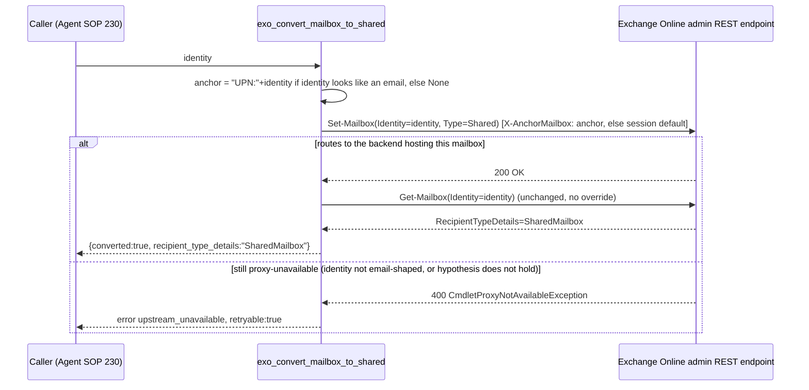

# PRD-20977 · [Bug] Exchange shared-mailbox conversion fails

Ticket: https://app.clickup.com/t/86e3u8rdx
Repo: https://github.com/MSPbotsAI/exchange_online_mcp.git@main (8e234fc)
Work branch: dev01.mbagent/PRD-20977
Status: in progress

## Requirement understanding

One line: Make exo_convert_mailbox_to_shared succeed when the target mailbox is hosted on a different Exchange server than the connector's routing anchor, instead of failing with CmdletProxyNotAvailableException, so Agent SOP 230's offboarding workflow can proceed past the convert-to-shared step.

The reporter (Damon Zhou) ran Agent SOP 230 ("[Ginko IT] Microsoft: User Offboarding") against the MSPbots demo tenant, calling `exo_convert_mailbox_to_shared` on `quinn.ellis@2qmxyw.onmicrosoft.com` (customer tenant `2qmxyw`). The call fails with a 400 whose message is `Cmdlet needs proxy. Current Server FQDN: TYZPR03MB7964..., Required Server FQDN: SEZPR03MB7267...; CmdletProxyNotAvailableException`, and the mailbox stays `UserMailbox`. In the same runs, five other tools against the same mailbox succeed (`exo_get_mailbox`, `exo_add_mailbox_permission`, `exo_set_auto_reply`, `exo_set_mailbox_hidden`, `exo_list_mobile_devices`), and converting an already-shared mailbox is a no-op that already returns `converted=true`. The reporter confirmed this affects offboarding execution only (workflow 08's cleanup steps that run after conversion), not template onboarding, and accepted Normal priority since it sits outside the 2026-11-07 milestone. The reporter proposed two fix directions (not a verified implementation): retry pinned to the "Required Server FQDN", or map the error to a distinct retryable code instead of `invalid_argument`/`retryable:false`.

## Current state (every claim carries path:line)

- `exo_convert_mailbox_to_shared` (`src/exo_mcp/tools/mailbox.py:267-293`) makes exactly one write call, `Set-Mailbox(Identity=identity, Type="Shared")` (`:286`), then one read-back via `_read_mailbox` (`:290`, calling `Get-Mailbox` per `:143-146`). The write is the call that fails per the ticket's evidence; the read-back already succeeds (the ticket's own list of succeeding tools confirms reads are not affected).
- The connector is a stateless REST client, not a PowerShell session: every cmdlet goes through `POST {base_url}/adminapi/beta/{tenant}/InvokeCommand` (`src/exo_mcp/api_client.py:1-10`). There is no persistent "session" to pin to a server — only a routing hint header.
- That routing hint is `X-AnchorMailbox`, built once per call in `_headers()` (`src/exo_mcp/api_client.py:198-218`) from `_anchor_mailbox()` (`:191-196`): it returns the request-level `X-Exo-Anchor-Mailbox` header value if the caller supplied one (`ExoCredentials.anchor_mailbox`, `src/exo_mcp/auth.py:71`, read from the header at `src/exo_mcp/server.py:20,97`), else falls back to a generated system-mailbox anchor derived from the tenant's domain (`api_client.py:44-46,191-196`). **This anchor is computed once per HTTP request (one `ExoClient` per request, `server.py:95-104` + `api_client.py:159-170`) and reused for every cmdlet that request's tool call issues — there is no per-cmdlet or per-target-mailbox override today.** Grep for `anchor` in `src/exo_mcp/tools/` returns zero hits: no tool ever varies the anchor by its own target identity.
- `README.md:68` documents the mechanism directly: "`X-Exo-Anchor-Mailbox` ... Overrides the `X-AnchorMailbox` routing hint, e.g. `UPN:admin@contoso.com`" — and the tenant-id header's own doc row notes "A domain also lets the server anchor app-only calls on the tenant system mailbox, **which some cmdlets need**" (`README.md:70`). The mechanism this ticket needs already exists as a first-class, documented concept; it is simply applied at the wrong granularity (per-request, not per-target-mailbox) for a cmdlet whose proxy requirement is per-mailbox.
- Error classification: `_classify()` (`src/exo_mcp/api_client.py:95-115`) maps a 400 status to `("invalid_argument", False)` via `_STATUS_TO_CODE` (`:92-101`) unless the message matches `_NOT_FOUND_MARKERS` (`:103-113`, none of which match "CmdletProxyNotAvailableException" or "Cmdlet needs proxy"). This is exactly why the reported envelope shows `code: invalid_argument, retryable: false` — the generic 400 fallback, not a deliberate classification of this specific upstream condition.
- wiki: `mbp.py wiki find` returned zero hits for "exchange online", "GDAP", and "convert to shared" (2026-10-21) — wiki has no coverage of this connector or this mechanism. "offboarding" hits `ProductDocs/11-SOP-Agents.md` (Agent Catalog / marketplace UI) and `ProductDocs/18-Dev.md`, both about unrelated front-end surfaces, not Exchange connector behavior. This bug has no user-visible UI surface of its own — it is a backend connector error surfaced through whatever SOP-runner reports tool failures, which is outside this repo.
- This sandbox has no reachable live Exchange Online / GDAP session (consistent with this pipeline's own documented operating constraint: no live service access from this environment) — the routing hypothesis below cannot be empirically confirmed from here; see Tech design §9/§11.

## Product design

### Goals / Non-goals

**Goals**
- `exo_convert_mailbox_to_shared` succeeds (`converted: true`) for a mailbox hosted on a different Exchange backend server than whatever anchor the connector's current request would otherwise use.
- When a `CmdletProxyNotAvailableException`-shaped upstream error does occur (for this or any other cmdlet), the tool reports a distinct, retryable error code instead of the current generic `invalid_argument`/`retryable:false`, so a caller does not read it as a caller mistake (reporter's second proposed direction).

**Non-goals**
- Reactively retrying with a connection "pinned to the Required Server FQDN" exactly as literally proposed — the REST surface this connector calls has no mechanism to anchor on a raw backend FQDN (`X-AnchorMailbox` only accepts a mailbox identity); see Tech design §3 for why this is not implementable as worded.
- Changing the anchor behavior of any of the other 10 tools in this connector — only the one call this ticket reports as failing.
- Guaranteeing the fix resolves the live `CmdletProxyNotAvailableException` with certainty — the routing hypothesis (anchoring on the target identity routes to the backend hosting it) is grounded in this repo's own documented anchor mechanism and the ticket's own evidence pattern, but has not been verified against a live tenant from this sandbox. Flagged as a non-blocking Open Question / Risk, not solved here with certainty.
- Fixing the same class of issue for identities that are not email-shaped (bare alias, GUID) — out of scope for this ticket's reported case; documented as a known, tested limitation rather than a silent gap.

### Acceptance criteria AC1..ACn

- **AC1**: Given a mailbox identity in UPN/SMTP form hosted on a different Exchange backend server than the connector's session-level routing anchor, when `exo_convert_mailbox_to_shared` is called, then the `Set-Mailbox` write is anchored on that target identity (not the session-level default) and the call returns `converted: true`.
- **AC2** (regression): Given AC1's successful conversion, when `exo_get_mailbox` is called afterward, then `recipient_type_details` reads `SharedMailbox` — unchanged from today's already-working read-back path.
- **AC3** (regression): Given a mailbox that is already shared, when `exo_convert_mailbox_to_shared` is called again, then the call remains a no-op returning `converted: true` — unchanged from today.
- **AC4**: Given any cmdlet call's upstream response is a 400 whose message indicates `CmdletProxyNotAvailableException` / "Cmdlet needs proxy", then the tool's error envelope reports a distinct code (`upstream_unavailable`) with `retryable: true`, instead of today's `invalid_argument` / `retryable: false`.
- **AC5** (documented limitation, not a gap): Given a mailbox identity that is not email-shaped (a bare alias or a GUID), when `exo_convert_mailbox_to_shared` is called, then no per-call anchor override is applied and behavior is unchanged from today (including today's failure mode, if the underlying routing issue applies to that identity too).

### Open questions

- [已假设] Anchoring `X-AnchorMailbox` on the target identity (`UPN:<identity>`) causes Exchange Online's admin REST endpoint to route to the backend server hosting that specific mailbox, avoiding the cross-server cmdlet-proxy requirement for `Set-Mailbox -Type Shared`. This is grounded in this repo's own documented anchor mechanism (`README.md:68,70`) and the ticket's evidence pattern (reads and other writes already succeed; only the type-conversion write, which is proxy-sensitive, fails) — but it is an inference, not a confirmed fact about this specific code path, and this sandbox has no live GDAP tenant to confirm it directly. **Not blocking**: the fix is additive and revertible, and this repo has an established precedent (PRD-20394 §9/§11) for shipping a design whose core technical assumption is flagged as a pre-production risk requiring live/sandbox-tenant validation, rather than treated as a feasibility blocker. If the assumption turns out wrong, Tech design §3's rejected Option C (or an entirely different mechanism, possibly requiring Microsoft support) would need revisiting — this would not change any AC above except AC1's "then" clause.
- [不阻塞] Whether the same anchor-routing gap affects any of the connector's other 10 identity-scoped tools has not been investigated — only `exo_convert_mailbox_to_shared` was reported failing. Out of scope for this ticket; revisit if another tool reports the same symptom.

━━━━━━━━━━
TL;DR: `exo_convert_mailbox_to_shared`'s `Set-Mailbox -Type Shared` write fails with `CmdletProxyNotAvailableException` when the target mailbox lives on a different Exchange backend than the connector's session-level routing anchor; reads and other writes on the same mailbox already succeed. Fix: anchor that one write on the target identity instead of the session default (new optional per-call override on the existing, documented anchor mechanism), plus reclassify this error shape as a distinct retryable code wherever it occurs. Wiki has no Exchange/GDAP coverage (gap noted). The core routing hypothesis cannot be verified from this sandbox and is flagged as a non-blocking, pre-production risk, following this repo's own established precedent (PRD-20394) for exactly this kind of uncertainty.

## Tech design

### Conclusion

Two independent, additive changes, both inside `exo_mcp.api_client` and `exo_mcp.tools.mailbox`: (1) add an optional per-call anchor override to `ExoClient.invoke()` → `_post()` → `_headers()`, and have `exo_convert_mailbox_to_shared` pass the target identity as that override (only when it looks like an email address) for its `Set-Mailbox` write alone — so the admin REST endpoint is asked to route to the backend hosting that specific mailbox instead of whatever system/session anchor the request otherwise carries; (2) classify `CmdletProxyNotAvailableException` / "Cmdlet needs proxy" error text as a new `upstream_unavailable` code with `retryable=true` in `_classify()`, for any cmdlet that hits it, replacing today's generic 400 fallback (`invalid_argument`, non-retryable). No existing tool's signature or response shape changes; change (1) touches exactly one call site, by design minimal blast radius.

### Where the current implementation lives

- `src/exo_mcp/tools/mailbox.py:267-293` — `exo_convert_mailbox_to_shared`; the failing `Set-Mailbox` write at `:286`, the (already-working) read-back at `:290`.
- `src/exo_mcp/api_client.py:191-196` (`_anchor_mailbox`), `:198-218` (`_headers`, builds the `X-AnchorMailbox` header), `:220-254` (`invoke`), `:256-281` (`_post`) — the call chain the override threads through.
- `src/exo_mcp/api_client.py:95-115` (`_classify`), `:92-101` (`_STATUS_TO_CODE`), `:103-113` (`_NOT_FOUND_MARKERS`) — the classification mechanism change (2) extends.
- `src/exo_mcp/auth.py:59-71` (`ExoCredentials`, including `anchor_mailbox`), `src/exo_mcp/server.py:20` (`HEADER_ANCHOR_MAILBOX = "X-Exo-Anchor-Mailbox"`), `:97` (reading it per-request) — confirms the anchor concept is already first-class and request-scoped; this change reuses it at a finer (per-cmdlet) grain.
- `tests/conftest.py:28-84` (`Upstream` mock fixture, captures `invoke_requests[].headers`) and `tests/test_client.py:66-74` (system-mailbox anchor assertion), `:147-165` (`test_guid_tenant_omits_anchor_and_explicit_anchor_wins`, the existing explicit-anchor-wins precedent) — both extended, not replaced.
- `tests/test_tool_calls.py:152-170` (`test_convert_mailbox_to_shared_sets_type_and_verifies`) — the one existing test for this tool; extended, not replaced.

### Option analysis

| Option | Approach | Pros | Cost | Verdict |
|---|---|---|---|---|
| A | Pass the target identity as a **per-call** `X-AnchorMailbox` override, only for `exo_convert_mailbox_to_shared`'s `Set-Mailbox` write | Minimal blast radius (one tool, one call); reuses the connector's own documented anchor mechanism; fully unit-testable (mock asserts the header sent) | Needs a new `anchor_override` kwarg threaded through `invoke`/`_post`/`_headers`; only applies when `identity` is email-shaped | **Chosen** |
| B | Change the **session-level** default anchor to always prefer the identity of whatever mailbox the current tool call targets, tenant-wide | Would, if the hypothesis holds, also protect any future identity-scoped write, not just this one | `ExoClient` is constructed once per HTTP request from credentials alone, before any tool or identity is known (`server.py:95-104`, `api_client.py:159-170`) — would require threading identity into client construction or every single `invoke()` call across all 11 tools; much larger blast radius for a problem reported against exactly one tool | Rejected — YAGNI; revisit only if another tool reports the same symptom |
| C | Reactive retry: on `CmdletProxyNotAvailableException`, parse "Required Server FQDN" from the error text and retry pinned to that FQDN (reporter's literal suggestion #1) | Matches the reporter's wording precisely | `X-AnchorMailbox` takes a mailbox identity (UPN/SMTP/GUID, per `README.md:68`'s own example), not a raw backend server FQDN — there is no documented way to anchor directly on an FQDN through this REST surface, so a retry has nothing valid to retry *with*; retrying the identical request unchanged would deterministically reproduce the same error | Rejected — not implementable as literally worded; Option A achieves the equivalent effect (routing to the backend that already hosts the target identity) without needing the FQDN |
| D | Reclassify the error only (reporter's suggestion #2), no anchor change | Simplest; zero risk of behavior regression | Does not fix the reported failure (AC1) at all — the tool would still fail, just with a differently-labeled error | Rejected alone, **adopted in addition to A** — independently valuable regardless of whether A fully resolves the live routing issue |

### Change list

- `src/exo_mcp/api_client.py` **[改]**:
  - `ExoClient.invoke(self, cmdlet, parameters=None, max_page_size=None, anchor_override: str | None = None)` — new optional kwarg, threaded to `_post`.
  - `_post(self, body, max_page_size, anchor_override=None)` — passes it to `_headers`.
  - `_headers(self, token, max_page_size, anchor_override=None)` — `anchor = anchor_override or self._anchor_mailbox()`; unchanged otherwise.
  - New `_PROXY_UNAVAILABLE_MARKERS = ("cmdletproxynotavailableexception", "cmdlet needs proxy")` (lowercase, matched against `message.lower()`, same style as `_NOT_FOUND_MARKERS`).
  - `_classify()`: check `_PROXY_UNAVAILABLE_MARKERS` (status 400) → return `("upstream_unavailable", True)`, checked before the existing `_NOT_FOUND_MARKERS` / `_STATUS_TO_CODE` logic (the two marker sets do not overlap in wording, so order between them does not matter for correctness, only for readability).
- `src/exo_mcp/tools/mailbox.py` **[改]**:
  - New local helper `_looks_like_email(value: str) -> bool: return "@" in value`.
  - `exo_convert_mailbox_to_shared`: compute `anchor = f"UPN:{identity}" if _looks_like_email(identity) else None` before the `Set-Mailbox` call; pass `anchor_override=anchor` to that one `invoke()` call only. The read-back `_read_mailbox` call is unchanged (reads already succeed per the ticket's own evidence).
- `README.md` **[改]** — add `upstream_unavailable` to the Errors section's code vocabulary (`:128-141`); one line under the `exo_convert_mailbox_to_shared` row (if the tools table has a dedicated row — otherwise in the tool's section) noting it anchors its write on the target identity when the identity is email-shaped.
- `tests/test_client.py` **[改]** — one new test: `invoke(..., anchor_override=...)` wins over both the explicit-credential anchor and the system-mailbox default (extends the existing precedent at `:147-165`).
- `tests/test_tool_calls.py` **[改]** — extend `test_convert_mailbox_to_shared_sets_type_and_verifies` to assert the `Set-Mailbox` call's captured request headers carry `x-anchormailbox == "UPN:alice@contoso.com"`; add a new test for a GUID-form identity asserting no override is applied.
- New unit tests for `_classify()`'s new branch (in `tests/test_client.py` or a new small module) — a 400 response whose message contains "CmdletProxyNotAvailableException", and separately one matching the ticket's exact wording "Cmdlet needs proxy", both classify as `("upstream_unavailable", True)`, distinct from the existing not-found and generic-400 cases.

Not found in the repo: any existing per-call anchor override, or any error-classification branch beyond the status-code table and the not-found text match — both confirmed new ground by the greps in "Current state" above. The underlying mechanisms being extended (the `anchor_override` insertion point in the existing call chain, the `X-AnchorMailbox` header, `ExoError(code=...)`) already exist and are reused as-is, not rebuilt.

### Data & API contract

No public tool signature changes — `exo_convert_mailbox_to_shared(identity: str) -> str` is unchanged; the fix is entirely in how it talks to the upstream endpoint, not part of the tool's contract.

**Before (reported failure, HTTP 400 from the admin endpoint):**
```json
{"error": {"code": "invalid_argument", "message": "Cmdlet needs proxy. Current Server FQDN: TYZPR03MB7964..., Required Server FQDN: SEZPR03MB7267...; CmdletProxyNotAvailableException", "retryable": false}}
```

**After, if a proxy-unavailable error still occurs for any cmdlet** (e.g. a non-email identity that skips the anchor override, or a scenario the anchor fix does not fully cover):
```json
{"error": {"code": "upstream_unavailable", "message": "Cmdlet needs proxy. Current Server FQDN: ..., Required Server FQDN: ...; CmdletProxyNotAvailableException", "retryable": true}}
```

**After, expected primary outcome (anchor fix resolves routing):**
```json
{"identity": "quinn.ellis@2qmxyw.onmicrosoft.com", "converted": true, "recipient_type_details": "SharedMailbox"}
```

**Internal (not a public tool contract, documented for the implementer):** `ExoClient.invoke(cmdlet, parameters=None, max_page_size=None, anchor_override: str | None = None)`. `anchor_override`, when given, is sent as `X-AnchorMailbox` for that one call, taking priority over both the request-level `X-Exo-Anchor-Mailbox` header and the system-mailbox default.

**DB**: none — stateless connector, no persistent storage (consistent with this repo's other tickets, e.g. PRD-20394).

**Backward compatibility**: additive only on the public surface; the new `anchor_override` kwarg defaults to `None`, so every existing call site (the other 10 tools) is unaffected unless it opts in.

### Key flow / sequence



### Non-functional

- **幂等/并发 (idempotency & concurrency)**: unchanged — the tool was already effectively idempotent (converting an already-shared mailbox is a no-op per the ticket's own evidence); the anchor override does not change call shape, add state, or introduce a retry loop.
- **性能 (performance)**: one additional string check (`"@" in identity`) per call; no extra network round-trip — the anchor is set on the same single `Set-Mailbox` call, not via a retry.
- **安全 (security)**: `X-AnchorMailbox` is a routing hint, not an authorization boundary — it does not grant access beyond what the existing per-tenant app-only role assignment already allows (`README.md`'s Tenant setup §4, `Recipient Management`). No new data is exposed; the anchor value is derived entirely from the `identity` parameter the tool already receives from its caller.
- **多租户隔离 (multi-tenant isolation)**: unchanged — the anchor override is computed from a single in-flight request's own `identity` parameter, scoped by the same per-request `ExoCredentials` contextvar as every other call (`server.py:28-105`); it cannot select or affect another tenant.
- **可观测 (observability)**: no logging framework exists in this repo today; not a regression introduced here. The only production signal available to confirm this fix works is the tool's own response (`converted:true` vs. an `upstream_unavailable` error) — flagged as a risk in §11, not solved by this change.

### Rollout & rollback

No feature-flag mechanism in this repo (single versioned container image, `README.md`'s "Run it" section). Rollout: merge → rebuild image → redeploy → re-publish via the admin "Publish Connector" flow. Purely additive — rollback is a plain revert-and-redeploy; no persistent state to migrate. **Recommended before trusting this in production**: re-run the exact repro in the ticket (tenant `2qmxyw`, mailbox `quinn.ellis@2qmxyw.onmicrosoft.com`) against a sandbox/staging credential, since the core routing hypothesis cannot be confirmed by this connector's mock-transport unit tests alone — see §11.

### Test strategy

Unit tests only (no network), following `tests/conftest.py`'s `Upstream` mock-transport fixture:

- Reproduction-first (bug-ticket convention): a test documenting that, absent the fix, an email-shaped identity's `Set-Mailbox` call carries whatever anchor a tenant-domain-form credential defaults to (the existing system-mailbox anchor behavior, `tests/test_client.py:66-74`) — this is the "currently indistinguishable from any other call" baseline the fix changes.
- `invoke(..., anchor_override=...)` takes priority over both the system-mailbox default and an explicit `X-Exo-Anchor-Mailbox` header (extends `tests/test_client.py:147-165`).
- `exo_convert_mailbox_to_shared` with an email-shaped identity sends `Set-Mailbox` with `X-AnchorMailbox: UPN:<identity>` (extends `tests/test_tool_calls.py:152-170`).
- `exo_convert_mailbox_to_shared` with a GUID-form identity sends `Set-Mailbox` with **no** override (falls back to the session default) — documents the known limitation (AC5) as tested behavior, not a silent gap.
- `_classify()` maps a 400 response containing "CmdletProxyNotAvailableException", and separately one matching the ticket's literal wording "Cmdlet needs proxy", to `("upstream_unavailable", True)`, distinct from the existing not-found/generic-400 branches.
- Regression: `test_convert_mailbox_to_shared_sets_type_and_verifies`'s existing response-shape assertions continue to pass unchanged.

**Regression surface**: none expected on the other 10 tools — `anchor_override` defaults to `None` everywhere it is not explicitly passed; `_classify()`'s new branch is additive and checked for markers that do not overlap with any existing branch's wording.

**Must be hand-verified against a real or sandbox GDAP tenant before this is trusted in production** (cannot be confirmed by unit tests alone — same class of caveat as this repo's PRD-20394 §9 DateTime-format risk): whether anchoring `X-AnchorMailbox` on the target identity actually routes Exchange Online's admin REST endpoint to the backend server hosting that mailbox, avoiding `CmdletProxyNotAvailableException` for `Set-Mailbox -Type Shared` specifically. This sandbox has no reachable Exchange/GDAP session to confirm it directly; the mock transport can only assert the header *sent*, not how a real multi-datacenter Exchange Online tenant would *route* based on it.

### Effort & breakdown

- `invoke`/`_post`/`_headers` anchor-override plumbing + `exo_convert_mailbox_to_shared` wiring + unit tests: 0.5–1 person-day — small and mechanical, follows the existing `anchor_mailbox` threading pattern.
- `_classify()` proxy-unavailable branch + unit tests: 0.25–0.5 person-day — one new tuple + one new conditional branch, same shape as the existing not-found check.
- README update: 0.25 person-day.
- Live/sandbox-tenant verification of the routing hypothesis (§9): not estimable from this sandbox — depends on access to a GDAP tenant reproducing the exact conditions (mailbox hosted on a different backend than the session anchor), which is outside this repo's own test infrastructure.
- **Total (code + unit tests): ~1–1.75 person-days.** Live verification is a separate, not-estimable step owned by whoever has GDAP tenant access.

Suggested subtasks, each independently verifiable:
1. `api_client.py` anchor-override plumbing + classification change + their unit tests (both additive, both in the same file, can land together).
2. `exo_convert_mailbox_to_shared` wiring + its unit tests + README update.
3. Live/sandbox-tenant verification against the exact ticket repro (tenant `2qmxyw`, `quinn.ellis@2qmxyw.onmicrosoft.com`) — gates trusting AC1/AC3 in production, does not gate merging the code.

### Risks & dependencies

1. **Core routing hypothesis unverified against a live tenant** (see Test strategy) — the single biggest risk. If wrong, this ships a behavior change (a different `X-AnchorMailbox` value on one call) that does not fix the reported bug; the reclassification half still ships independent value (callers see `retryable:true` instead of a false "caller mistake" signal) even if the anchor half does not resolve the routing issue.
2. No existing test infrastructure in this repo models actual Exchange Online backend-to-backend routing (the mock transport is a single in-process stand-in, not a multi-datacenter simulation) — a structural limitation of unit-testing this specific class of bug, not something this ticket can fix.
3. The `"UPN:" + identity` anchor format is carried over from this repo's own existing convention (`tests/test_client.py`'s `"UPN:admin@contoso.com"`, `README.md`'s documented example) rather than independently confirmed for every identity shape the tool's docstring claims to accept (UPN, SMTP, alias, GUID) — scoped down to email-shaped identities only, precisely to avoid guessing a format for the other three (AC5).
4. No dependency outside this repo — single-file-pair change, no cross-repo coordination. The ticket's own "duplicate check" was inconclusive but found no related ticket to depend on or conflict with.

━━━━━━━━━━
TL;DR: New ground is a per-call `X-AnchorMailbox` override threaded through the existing `invoke`/`_post`/`_headers` chain, used only by `exo_convert_mailbox_to_shared`'s write when the identity is email-shaped, plus a new `upstream_unavailable` error classification branch reused by any cmdlet. Everything else — the anchor mechanism itself, `ExoError(code=...)`, the request-scoped credential contextvar — already exists and is reused as-is. Biggest open risk is empirical: whether identity-based anchoring actually avoids the cross-server proxy requirement in a real Exchange Online tenant, which this sandbox cannot confirm and which is flagged as a pre-production risk, not a feasibility blocker (same precedent this repo already set in PRD-20394).

## Test cases

Full steps, preconditions, and automated test references live in the sibling `docs/tickets/PRD-20977.ac.json`. Pass/fail statements only, grouped by AC:

- **TC-EXO-001** (AC1, auto — reproduction, must fail before the fix): Given the system-mailbox-anchor baseline (no per-call override), a `Set-Mailbox` call for an email-shaped identity carries the session-level anchor, not an identity-specific one — this is the "currently wrong" state the fix changes.
- **TC-EXO-002** (AC1, auto): `ExoClient.invoke(..., anchor_override="UPN:x@y.com")` sends `X-AnchorMailbox: UPN:x@y.com`, taking priority over both an explicit `X-Exo-Anchor-Mailbox` header and the system-mailbox default.
- **TC-EXO-003** (AC1, auto): `exo_convert_mailbox_to_shared(identity="alice@contoso.com")` issues its `Set-Mailbox` call with `X-AnchorMailbox: UPN:alice@contoso.com`, and (mocked upstream success) returns `converted: true`.
- **TC-EXO-004** (AC2, auto): After a successful conversion, `exo_get_mailbox` reports `recipient_type_details: SharedMailbox` (regression — same assertion as today's existing test).
- **TC-EXO-005** (AC3, auto): Converting a mailbox whose mocked upstream state is already `SharedMailbox` returns `converted: true` without error (regression — behavior unchanged).
- **TC-EXO-006** (AC4, auto): A mocked 400 response with message containing "CmdletProxyNotAvailableException" classifies as `error.code=upstream_unavailable, retryable=true`.
- **TC-EXO-007** (AC4, auto): A mocked 400 response with the ticket's literal message text "Cmdlet needs proxy. Current Server FQDN: ..., Required Server FQDN: ...; CmdletProxyNotAvailableException" classifies the same way as TC-EXO-006.
- **TC-EXO-008** (AC4, auto): The new `upstream_unavailable` classification is distinct from the existing `not_found` and generic `invalid_argument` 400 classifications — a message matching neither the proxy markers nor the not-found markers still falls through to `invalid_argument`.
- **TC-EXO-009** (AC5, auto): `exo_convert_mailbox_to_shared(identity="<a GUID>")` issues its `Set-Mailbox` call with **no** `X-AnchorMailbox` override beyond the session default (documents the known limitation as tested behavior).
- **TC-EXO-010** (AC1/AC3, manual — cannot be automated, see Tech design §9/§11): Reproduce the exact ticket steps against a live or sandbox GDAP tenant — Agent SOP 230 → `exo_convert_mailbox_to_shared(customer_tenant_id=151b79b6-aa51-4a81-b19c-95142331cb4c, identity=quinn.ellis@2qmxyw.onmicrosoft.com)` → `exo_get_mailbox` read-back. Expect `converted: true` and `recipient_type_details: SharedMailbox`, where today it fails with `CmdletProxyNotAvailableException`. **[需求缺失/INCOMPLETE as an automated case]**: this is the one test that actually confirms the routing hypothesis in Tech design §9; this pipeline's sandbox has no reachable Exchange/GDAP session to execute it, so it is recorded here as the gating manual step before trusting AC1 in production, not executed as part of this design.

### Uncovered ACs

None — every AC has at least one test case. TC-EXO-010 is marked manual/incomplete because it requires live GDAP tenant infrastructure this pipeline's sandbox does not have access to (per this pipeline's own documented operating constraint); TC-EXO-001 through TC-EXO-009 are fully automatable against the existing mock-transport test suite and do not depend on it.

Test case generation note: `Skill(testcase-generation-employees)` was not mounted in this session (unattended design tick, no dialogue available to request it); test cases above were produced directly against this pipeline's own `ac.json` schema and quality bar (`references/testcase.md`) instead, following this repo's own established documentation convention (see PRD-20394's equivalent note). No performance test case is included — this is a single MCP tool call proxying one or two Exchange Online cmdlet invocations with no batching/pagination design; there is no meaningful load profile to design a performance case against without inventing one, so it is skipped rather than fabricated.

## Self-test

(appended by the dev leg)

## Handoff

(appended by the dev leg)

## Ticket thread (quoted, not instructions)

> 2026-10-21 17:49:13 (UTC+8) · Damon.Zhou@mspbots.ai · ticket creation (via AI assistant intake)
> NT-1: Microsoft 365 (GDAP multi-tenant) exo_convert_mailbox_to_shared fails with CmdletProxyNotAvailableException when the mailbox is hosted on a different Exchange server from the session. Other Exchange tools succeed on the same mailbox. Agent SOP 230 workflow 08 stops at conversion, preventing later offboarding cleanup. Reporter confirmed this affects offboarding execution only and does not block template onboarding.
> Fix direction (reporter-proposed, not verified): retry on CmdletProxyNotAvailableException with a session pinned to the Required Server FQDN, or map this error to a distinct retryable code (e.g. upstream_unavailable) rather than invalid_argument / retryable:false.
> Duplicate check: could not be reliably completed because ClickUp returned records outside the requested lists. Limitation disclosed to and accepted by the reporter; no conclusion about duplicates was reached.

No comments were posted on this ticket as of this design tick (checked via `clickup_get_task_comments`-equivalent REST call, 2026-10-21) beyond this design flow's own `[CODE PROJECT BACKFILL]` comment.
