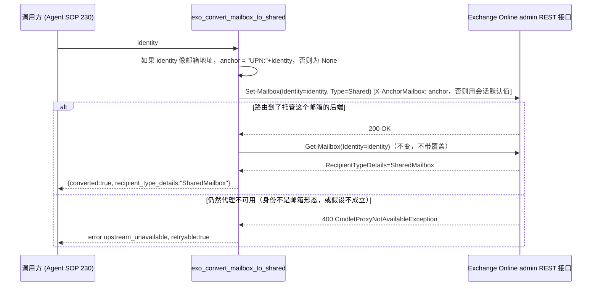

# PRD-20977 · [Bug] Exchange shared-mailbox conversion fails

工单: https://app.clickup.com/t/86e3u8rdx
仓库: https://github.com/MSPbotsAI/exchange_online_mcp.git@main (8e234fc)
工作分支: dev01.mbagent/PRD-20977
状态: 进行中

## 需求理解

一句话：让 exo_convert_mailbox_to_shared 在目标邮箱托管于与连接器路由锚点不同的 Exchange 后端服务器时也能成功，而不是报 CmdletProxyNotAvailableException，从而让 Agent SOP 230 的 offboarding 工作流能走过 convert-to-shared 这一步。

提单人（Damon Zhou）在 MSPbots demo 租户上跑 Agent SOP 230（“[Ginko IT] Microsoft: User Offboarding”），对 `quinn.ellis@2qmxyw.onmicrosoft.com`（客户租户 `2qmxyw`）调用 `exo_convert_mailbox_to_shared`。调用返回 400，消息是 `Cmdlet needs proxy. Current Server FQDN: TYZPR03MB7964..., Required Server FQDN: SEZPR03MB7267...; CmdletProxyNotAvailableException`，邮箱仍是 `UserMailbox`。同一批运行里，对同一个邮箱的另外五个工具都成功（`exo_get_mailbox`、`exo_add_mailbox_permission`、`exo_set_auto_reply`、`exo_set_mailbox_hidden`、`exo_list_mobile_devices`），且对一个已经是共享邮箱的对象再转换一次也已经是空操作、返回 `converted=true`。提单人确认这只影响 offboarding 执行（workflow 08 在转换之后的清理步骤），不影响模板 onboarding，并接受了 Normal 优先级（不在 2026-11-07 里程碑范围内）。提单人提出了两个修复方向（未经验证的实现建议）：用固定到 "Required Server FQDN" 的会话重试，或者把这个错误映射成一个独立的、可重试的错误码而不是 `invalid_argument` / `retryable:false`。

## 现状（每条论断都带 path:line）

- `exo_convert_mailbox_to_shared`（`src/exo_mcp/tools/mailbox.py:267-293`）只发出一次写调用，`Set-Mailbox(Identity=identity, Type="Shared")`（`:286`），然后用 `_read_mailbox` 读回一次（`:290`，调用 `:143-146` 的 `Get-Mailbox`）。按工单证据，失败的是这次写调用；读回本身已经成功（工单自己列出的「成功工具清单」证实读操作不受影响）。
- 这个连接器是无状态的 REST 客户端，不是 PowerShell 会话：每个 cmdlet 都走 `POST {base_url}/adminapi/beta/{tenant}/InvokeCommand`（`src/exo_mcp/api_client.py:1-10`）。没有可以「固定到某台服务器」的持久会话，只有一个路由提示头。
- 这个路由提示就是 `X-AnchorMailbox`，在 `_headers()`（`src/exo_mcp/api_client.py:198-218`）里按每次调用构造，取自 `_anchor_mailbox()`（`:191-196`）：如果调用方传了请求级 `X-Exo-Anchor-Mailbox` 头就用它（`ExoCredentials.anchor_mailbox`，`src/exo_mcp/auth.py:71`，在 `src/exo_mcp/server.py:20,97` 读取该头），否则回退到按租户域名生成的系统邮箱锚点（`api_client.py:44-46,191-196`）。**这个锚点是按每个 HTTP 请求计算一次的（一个请求对应一个 `ExoClient`，`server.py:95-104` + `api_client.py:159-170`），该请求发出的每一个 cmdlet 都复用同一个值——今天没有任何按 cmdlet 或按目标邮箱单独覆盖的机制。** 在 `src/exo_mcp/tools/` 下搜 `anchor` 零命中：没有任何工具会按自己的目标身份去改变锚点。
- `README.md:68` 直接记录了这个机制：“`X-Exo-Anchor-Mailbox` ... Overrides the `X-AnchorMailbox` routing hint, e.g. `UPN:admin@contoso.com`”——而租户 id 那一行自己的文档也写着“域名形式的租户 id 还能让服务端把 app-only 调用锚定到租户系统邮箱，**有些 cmdlet 需要这个**”（`README.md:70`）。这张单需要的机制其实已经存在，是一个一等公民、有文档记录的概念；只是用错了粒度（按请求而不是按目标邮箱），而这个 cmdlet 的代理需求恰恰是按邮箱的。
- 错误分类：`_classify()`（`src/exo_mcp/api_client.py:95-115`）把 400 状态码映射成 `("invalid_argument", False)`（经由 `_STATUS_TO_CODE`，`:92-101`），除非消息命中 `_NOT_FOUND_MARKERS`（`:103-113`，没有一条能命中 "CmdletProxyNotAvailableException" 或 "Cmdlet needs proxy"）。这正是工单报的返回体是 `code: invalid_argument, retryable: false` 的原因——是通用 400 兜底，而不是对这个具体上游情况的有意分类。
- wiki：`mbp.py wiki find` 对 "exchange online"、"GDAP"、"convert to shared" 全部零命中（2026-10-21）——wiki 没有覆盖这个连接器或这个机制。"offboarding" 命中了 `ProductDocs/11-SOP-Agents.md`（Agent 目录/市场 UI）和 `ProductDocs/18-Dev.md`，都是不相关的前端界面，不涉及 Exchange 连接器行为。这个 bug 本身没有用户可见的界面——它是一个后端连接器错误，具体怎么呈现给用户取决于 SOP runner 怎么上报工具失败，那部分不在本仓库里。
- 本沙箱没有可达的实时 Exchange Online / GDAP 会话（与本流水线自身记录的运行约束一致：这个环境连不上线上服务）——下面的路由假设无法从这里实证验证；见技术设计 §9/§11。

## 产品设计

### 目标 / 非目标

**目标**
- 当目标邮箱托管在与连接器当前请求本会用到的锚点不同的 Exchange 后端服务器上时，`exo_convert_mailbox_to_shared` 也能成功（`converted: true`）。
- 当确实发生 `CmdletProxyNotAvailableException` 形状的上游错误时（无论是这个还是其它 cmdlet），工具要报告一个独立的、可重试的错误码，而不是现在这种通用的 `invalid_argument`/`retryable:false`，这样调用方不会把它当成自己传参错了（提单人第二个建议方向）。

**非目标**
- 按字面意思做「把会话固定到 Required Server FQDN」的被动重试——这个连接器调用的 REST 接口没有按原始后端 FQDN 做锚定的机制（`X-AnchorMailbox` 只接受邮箱身份）；原因见技术设计 §3。
- 改动连接器里其它 10 个工具的锚点行为——只动工单报告的这一次调用。
- 100% 确保这个修复能解决线上真实的 `CmdletProxyNotAvailableException`——路由假设（按目标身份锚定会路由到托管该邮箱的后端）有本仓库自己记录的锚点机制和工单自身的证据模式支撑，但没有在真实租户上验证过。标为不阻塞的 Open Question / 风险，这里不对它打包票。
- 修复同一类问题在非邮箱形态身份（裸别名、GUID）上的表现——不在本单报告范围内，记为已知且有测试覆盖的限制，而不是悄悄留下的缺口。

### 验收标准 AC1..ACn

- **AC1**：给定一个 UPN/SMTP 形式的邮箱身份，托管在与连接器会话级路由锚点不同的 Exchange 后端服务器上，当调用 `exo_convert_mailbox_to_shared` 时，`Set-Mailbox` 写调用会锚定在该目标身份上（而不是会话级默认值），并且调用返回 `converted: true`。
- **AC2**（回归）：给定 AC1 转换成功，之后调用 `exo_get_mailbox` 时，`recipient_type_details` 读到 `SharedMailbox`——与今天已经可用的读回路径一致，不变。
- **AC3**（回归）：给定一个已经是共享邮箱的对象，再次调用 `exo_convert_mailbox_to_shared` 时，仍是空操作并返回 `converted: true`——与今天一致，不变。
- **AC4**：给定任意 cmdlet 调用的上游响应是一个消息指示 `CmdletProxyNotAvailableException` / "Cmdlet needs proxy" 的 400，工具的错误返回体报告一个独立的 `upstream_unavailable` 错误码，`retryable: true`，而不是今天的 `invalid_argument` / `retryable: false`。
- **AC5**（已记录的限制，不是缺口）：给定一个非邮箱形态的身份（裸别名或 GUID），当调用 `exo_convert_mailbox_to_shared` 时，不施加按次锚点覆盖，行为与今天一致（包括今天的失败模式，如果底层路由问题同样适用于这类身份）。

### Open Questions

- [已假设] 把 `X-AnchorMailbox` 锚定到目标身份（`UPN:<identity>`）会让 Exchange Online 的 admin REST 接口路由到托管那个具体邮箱的后端服务器，从而绕开 `Set-Mailbox -Type Shared` 的跨服务器 cmdlet 代理需求。这个判断有本仓库自己记录的锚点机制（`README.md:68,70`）和工单的证据模式（读操作和其它写操作都已成功，只有对代理敏感的类型转换写操作失败）支撑——但这是一个推论，不是对这条具体代码路径的已确认事实，本沙箱也没有真实 GDAP 租户可以直接验证。**不阻塞**：这个修复是增量式且可回退的，本仓库已有先例（PRD-20394 §9/§11）——把核心技术假设标为上线前需要验证的风险，而不是当成可行性阻塞。如果这个假设被证明是错的，技术设计 §3 里被否决的方案 C（或者完全不同的机制，可能需要联系微软支持）需要重新考虑——那不会改变上面任何一条 AC，只会改变 AC1 的「then」部分。
- [不阻塞] 同样的锚点路由问题是否也影响连接器其它 10 个按身份操作的工具，目前未调查——只有 `exo_convert_mailbox_to_shared` 被报告失败。不在本单范围内；如果其它工具也报同样的症状再处理。

━━━━━━━━━━
TL;DR：当目标邮箱所在的 Exchange 后端与连接器的会话级路由锚点不同时，`exo_convert_mailbox_to_shared` 的 `Set-Mailbox -Type Shared` 写调用会报 `CmdletProxyNotAvailableException`；对同一邮箱的读操作和其它写操作都已经成功。修复：把这一次写调用锚定到目标身份而不是会话默认值（在已有的、有文档记录的锚点机制上新增一个按次覆盖），并把这种错误形状在任何地方出现时都重新分类成一个独立的可重试错误码。wiki 没有 Exchange/GDAP 覆盖（已记录为缺口）。核心路由假设无法在本沙箱验证，按本仓库已有先例（PRD-20394）标为不阻塞的上线前风险。

## 技术设计

### 结论

两处独立的增量改动，都在 `exo_mcp.api_client` 和 `exo_mcp.tools.mailbox` 内：(1) 给 `ExoClient.invoke()` → `_post()` → `_headers()` 这条调用链加一个可选的按次锚点覆盖参数，`exo_convert_mailbox_to_shared` 只在身份看起来像邮箱地址时，把目标身份作为覆盖值传给它唯一的那次 `Set-Mailbox` 写调用——这样 admin REST 接口就会被要求路由到托管那个具体邮箱的后端，而不是这次请求本来携带的系统/会话锚点；(2) 在 `_classify()` 里把 `CmdletProxyNotAvailableException` / "Cmdlet needs proxy" 这类错误文本分类成新的 `upstream_unavailable` 错误码、`retryable=true`，对任何命中它的 cmdlet 都生效，替换掉今天的通用 400 兜底（`invalid_argument`，不可重试）。没有任何现有工具的签名或返回形状发生变化；改动 (1) 只影响一个调用点，刻意把影响面做到最小。

### 现有实现定位

- `src/exo_mcp/tools/mailbox.py:267-293` —— `exo_convert_mailbox_to_shared`；失败的 `Set-Mailbox` 写调用在 `:286`，已经可用的读回在 `:290`。
- `src/exo_mcp/api_client.py:191-196`（`_anchor_mailbox`）、`:198-218`（`_headers`，构造 `X-AnchorMailbox` 头）、`:220-254`（`invoke`）、`:256-281`（`_post`）—— 覆盖参数要穿过的调用链。
- `src/exo_mcp/api_client.py:95-115`（`_classify`）、`:92-101`（`_STATUS_TO_CODE`）、`:103-113`（`_NOT_FOUND_MARKERS`）—— 改动 (2) 要扩展的分类机制。
- `src/exo_mcp/auth.py:59-71`（`ExoCredentials`，含 `anchor_mailbox`）、`src/exo_mcp/server.py:20`（`HEADER_ANCHOR_MAILBOX = "X-Exo-Anchor-Mailbox"`）、`:97`（按请求读取）—— 证实锚点这个概念本来就是一等公民、按请求生效；这次改动只是在更细的粒度（按 cmdlet）上复用它。
- `tests/conftest.py:28-84`（`Upstream` mock fixture，会记录 `invoke_requests[].headers`）与 `tests/test_client.py:66-74`（系统邮箱锚点断言）、`:147-165`（`test_guid_tenant_omits_anchor_and_explicit_anchor_wins`，已有的「显式锚点优先」先例）—— 两者都是扩展，不是替换。
- `tests/test_tool_calls.py:152-170`（`test_convert_mailbox_to_shared_sets_type_and_verifies`）—— 这个工具现有的唯一测试；扩展，不替换。

### 方案选型

| 方案 | 做法 | 优点 | 代价 | 结论 |
|---|---|---|---|---|
| A | 只在 `exo_convert_mailbox_to_shared` 的 `Set-Mailbox` 写调用上，按次传入目标身份作为 `X-AnchorMailbox` 覆盖 | 影响面最小（一个工具、一次调用）；复用连接器自己已有文档记录的锚点机制；完全可单测（mock 断言实际发出的头） | 需要给 `invoke`/`_post`/`_headers` 加一个新的 `anchor_override` 参数并穿透过去；只在 `identity` 像邮箱地址时生效 | **采用** |
| B | 把**会话级**默认锚点全局改成「总是优先用当前调用目标邮箱的身份」，全租户生效 | 如果假设成立，将来任何按身份操作的写调用都能受益，不只这一个 | `ExoClient` 是每个 HTTP 请求只构造一次、仅凭凭据构造（`server.py:95-104`、`api_client.py:159-170`），在知道是哪个工具、哪个身份之前——要做到这点得把身份传进客户端构造或每一次 `invoke()` 调用，涉及全部 11 个工具；对一个只有一个工具报告过的问题来说影响面大得多 | 否决——YAGNI；只有其它工具也报同样症状时才重新考虑 |
| C | 被动重试：命中 `CmdletProxyNotAvailableException` 后，从错误文本里解析 "Required Server FQDN"，重试时固定到那台 FQDN（提单人字面建议 #1） | 完全贴合提单人的措辞 | `X-AnchorMailbox`（按 `README.md:68` 自己的例子）接受的是邮箱身份（UPN/SMTP/GUID），不是原始后端服务器 FQDN——这个 REST 接口没有文档记录的方式能直接锚定到一个 FQDN，所以重试没有合法的东西可以「重试用」；原样重试同一个请求只会确定性地再现同一个错误 | 否决——按字面没法实现；方案 A 不需要那个 FQDN，也能达到等价效果（路由到已经托管目标身份的后端） |
| D | 只做错误重新分类（提单人建议 #2），不动锚点 | 最简单；零行为回归风险 | 完全不能修复工单报告的失败（AC1）——工具还是会失败，只是错误标签换了个名字 | 单独使用时否决，**与 A 一并采用**——无论 A 能否彻底解决真实路由问题，这一条本身都有独立价值 |

### 改动清单

- `src/exo_mcp/api_client.py` **[改]**：
  - `ExoClient.invoke(self, cmdlet, parameters=None, max_page_size=None, anchor_override: str | None = None)` —— 新增可选参数，一路传给 `_post`。
  - `_post(self, body, max_page_size, anchor_override=None)` —— 传给 `_headers`。
  - `_headers(self, token, max_page_size, anchor_override=None)` —— `anchor = anchor_override or self._anchor_mailbox()`；其余不变。
  - 新增 `_PROXY_UNAVAILABLE_MARKERS = ("cmdletproxynotavailableexception", "cmdlet needs proxy")`（小写，对 `message.lower()` 做匹配，写法和 `_NOT_FOUND_MARKERS` 一致）。
  - `_classify()`：先检查 `_PROXY_UNAVAILABLE_MARKERS`（状态码 400）→ 返回 `("upstream_unavailable", True)`，检查顺序放在现有 `_NOT_FOUND_MARKERS` / `_STATUS_TO_CODE` 逻辑之前（两组关键词在措辞上不重叠，所以谁先谁后不影响正确性，只影响可读性）。
- `src/exo_mcp/tools/mailbox.py` **[改]**：
  - 新增本地辅助函数 `_looks_like_email(value: str) -> bool: return "@" in value`。
  - `exo_convert_mailbox_to_shared`：在 `Set-Mailbox` 调用之前计算 `anchor = f"UPN:{identity}" if _looks_like_email(identity) else None`；只给这一次 `invoke()` 调用传 `anchor_override=anchor`。读回用的 `_read_mailbox` 调用不变（按工单证据读操作本来就成功）。
- `README.md` **[改]** —— 在 Errors 一节的错误码词表（`:128-141`）里加入 `upstream_unavailable`；在 `exo_convert_mailbox_to_shared` 那一行（或该工具的说明段落）下加一句，说明身份是邮箱形态时它会把写调用锚定到目标身份。
- `tests/test_client.py` **[改]** —— 新增一条测试：`invoke(..., anchor_override=...)` 优先级高于显式凭据锚点和系统邮箱默认值两者（扩展 `:147-165` 已有的先例）。
- `tests/test_tool_calls.py` **[改]** —— 扩展 `test_convert_mailbox_to_shared_sets_type_and_verifies`，断言 `Set-Mailbox` 调用捕获到的请求头里 `x-anchormailbox == "UPN:alice@contoso.com"`；新增一条 GUID 形态身份的测试，断言不施加覆盖。
- 为 `_classify()` 新分支新增单测（放在 `tests/test_client.py` 或新模块）—— 一个消息包含 "CmdletProxyNotAvailableException" 的 400 响应，以及另一个完全匹配工单原文 "Cmdlet needs proxy" 的响应，都分类成 `("upstream_unavailable", True)`，与现有的 not-found、通用 400 分支区分开。

本仓库里没有找到：任何现成的按次锚点覆盖，或者超出状态码表和 not-found 文本匹配之外的错误分类分支——以上「现状」里的 grep 都确认了这是新增的内容。被扩展的底层机制（既有调用链上插入 `anchor_override` 的位置、`X-AnchorMailbox` 头、`ExoError(code=...)`）本来就存在，是复用，不是重建。

### 数据与接口契约

公开工具签名不变 —— `exo_convert_mailbox_to_shared(identity: str) -> str` 没有变化；这次修复全部发生在它跟上游通信的方式里，不属于这个工具对外的契约。

**修复前（工单报告的失败，上游返回 HTTP 400）：**
```json
{"error": {"code": "invalid_argument", "message": "Cmdlet needs proxy. Current Server FQDN: TYZPR03MB7964..., Required Server FQDN: SEZPR03MB7267...; CmdletProxyNotAvailableException", "retryable": false}}
```

**修复后，如果任意 cmdlet 仍然遇到代理不可用的错误**（例如身份不是邮箱形态所以跳过了锚点覆盖，或者假设没有覆盖到的其它场景）：
```json
{"error": {"code": "upstream_unavailable", "message": "Cmdlet needs proxy. Current Server FQDN: ..., Required Server FQDN: ...; CmdletProxyNotAvailableException", "retryable": true}}
```

**修复后，预期的主要结果（锚点修复解决了路由问题）：**
```json
{"identity": "quinn.ellis@2qmxyw.onmicrosoft.com", "converted": true, "recipient_type_details": "SharedMailbox"}
```

**内部实现（不是对外工具契约，为实现者记录）：** `ExoClient.invoke(cmdlet, parameters=None, max_page_size=None, anchor_override: str | None = None)`。`anchor_override` 一旦给出，会在这一次调用里作为 `X-AnchorMailbox` 发出，优先级高于请求级的 `X-Exo-Anchor-Mailbox` 头和系统邮箱默认值两者。

**数据库**：无——无状态连接器，没有持久化存储（与本仓库其它工单如 PRD-20394 一致）。

**向后兼容**：对外接口上纯增量；新增的 `anchor_override` 参数默认 `None`，所以其它 10 个工具的现有调用点在没有主动传入的情况下完全不受影响。

### 关键流程时序



### 非功能

- **幂等/并发**：不变——这个工具本来就基本是幂等的（对已经共享的邮箱再转换是空操作，工单自己的证据也证实了这点）；锚点覆盖不改变调用形状、不引入状态、也不引入重试循环。
- **性能**：每次调用多一次字符串检查（`"@" in identity`）；没有额外的网络往返——锚点是设在同一次 `Set-Mailbox` 调用上，不是通过重试。
- **安全**：`X-AnchorMailbox` 是路由提示，不是授权边界——它不会让调用方拿到超出现有按租户 app-only 角色分配（`README.md` 的 Tenant setup §4，`Recipient Management`）之外的访问权限。没有暴露新数据；锚点值完全来自工具已经从调用方拿到的 `identity` 参数。
- **多租户隔离**：不变——锚点覆盖是从单次在途请求自己的 `identity` 参数算出来的，受同一个按请求的 `ExoCredentials` contextvar 约束（`server.py:28-105`），不可能选到或影响另一个租户。
- **可观测**：本仓库今天没有日志框架；这次改动不引入回归。确认这次修复在生产环境是否真的有效，目前唯一可用的信号就是工具自己的返回值（`converted:true` 还是 `upstream_unavailable` 错误）——在 §11 里标为风险，这次改动本身不解决这个问题。

### 上线与回滚

本仓库没有 feature flag 机制（单一版本化容器镜像，见 `README.md` 的 "Run it" 一节）。上线：合并 → 重新构建镜像 → 重新部署 → 通过 admin 的 "Publish Connector" 流程重新发布。纯增量——回滚就是直接 revert 再重新部署；没有持久状态需要迁移。**上线前建议做的事**：用沙箱/预发凭据重跑工单里的原始复现步骤（租户 `2qmxyw`、邮箱 `quinn.ellis@2qmxyw.onmicrosoft.com`），因为核心路由假设没法只靠这个连接器的 mock-transport 单测来确认——见 §11。

### 测试策略

只有单元测试（不接网络），沿用 `tests/conftest.py` 的 `Upstream` mock-transport fixture：

- 先写复现用例（bug 单的惯例）：一条测试记录「在修复之前」，一个邮箱形态身份的 `Set-Mailbox` 调用会带上租户域名形式凭据默认生成的那个系统邮箱锚点（现有行为，`tests/test_client.py:66-74`）——这是修复要改变的「目前区分不出来」的基线。
- `invoke(..., anchor_override=...)` 的优先级高于系统邮箱默认值和显式 `X-Exo-Anchor-Mailbox` 头两者（扩展 `tests/test_client.py:147-165`）。
- 邮箱形态身份调用 `exo_convert_mailbox_to_shared` 时，其 `Set-Mailbox` 调用带 `X-AnchorMailbox: UPN:<identity>`（扩展 `tests/test_tool_calls.py:152-170`）。
- GUID 形态身份调用 `exo_convert_mailbox_to_shared` 时，其 `Set-Mailbox` 调用**不**带覆盖（回退到会话默认值）——把已知限制（AC5）记录成有测试覆盖的行为，而不是悄悄留下的缺口。
- `_classify()` 把一个消息包含 "CmdletProxyNotAvailableException" 的 400 响应，以及另一个完全匹配工单原文 "Cmdlet needs proxy" 的响应，都映射成 `("upstream_unavailable", True)`，与现有的 not-found、通用 400 分支区分开。
- 回归：`test_convert_mailbox_to_shared_sets_type_and_verifies` 现有的返回形状断言继续原样通过。

**回归面**：预期其它 10 个工具不受影响——`anchor_override` 在没有显式传入的地方默认是 `None`；`_classify()` 新分支是增量式的，匹配的关键词和现有任何分支的措辞都不重叠。

**在信任这次修复可以上生产之前，必须用真实或沙箱 GDAP 租户手工验证**（单测本身没法确认这点——和本仓库 PRD-20394 §9 里 DateTime 格式那条风险是同一类问题）：把 `X-AnchorMailbox` 锚定到目标身份，是否真的会让 Exchange Online 的 admin REST 接口路由到托管那个邮箱的后端，从而绕开 `Set-Mailbox -Type Shared` 特有的跨服务器 cmdlet 代理需求。本沙箱没有可达的 Exchange/GDAP 会话可以直接确认这点；mock transport 只能断言「发出去的头是什么」，没法模拟真实的多数据中心 Exchange Online 租户会怎么根据这个头去路由。

### 工作量与拆分

- `invoke`/`_post`/`_headers` 的锚点覆盖管道 + `exo_convert_mailbox_to_shared` 接线 + 单测：0.5–1 人日——改动小且机械，沿用已有的 `anchor_mailbox` 穿透模式。
- `_classify()` 的代理不可用分支 + 单测：0.25–0.5 人日——一个新元组 + 一个新条件分支，和现有 not-found 检查同形状。
- README 更新：0.25 人日。
- 路由假设的真实/沙箱租户验证（§9）：本沙箱无法估算——依赖能复现「邮箱托管在与会话锚点不同后端」这一确切条件的 GDAP 租户访问权限，这在本仓库自己的测试基础设施之外。
- **合计（代码 + 单测）：约 1–1.75 人日。** 真实环境验证是单独的、由拥有 GDAP 租户访问权限的人负责的、无法估算工期的一步。

建议拆分，每个子任务都可独立验收：
1. `api_client.py` 的锚点覆盖管道 + 分类改动 + 各自单测（都是增量式改动、都在同一个文件里，可以一起交付）。
2. `exo_convert_mailbox_to_shared` 接线 + 其单测 + README 更新。
3. 针对工单原始复现步骤（租户 `2qmxyw`、`quinn.ellis@2qmxyw.onmicrosoft.com`）的真实/沙箱租户验证——这一步决定能否信任 AC1/AC3 用于生产，但不卡代码合入。

### 风险与依赖

1. **核心路由假设未经真实租户验证**（见测试策略）——最大的风险。如果假设是错的，这次改动会在一次调用上改变 `X-AnchorMailbox` 的值，但不能修复工单报告的问题；重新分类那一半仍然有独立价值（调用方会看到 `retryable:true` 而不是一个误导性的「调用方自己传错了参数」的信号），即便锚点那一半没能解决路由问题。
2. 本仓库现有测试基础设施不能模拟真实的 Exchange Online 后端间路由（mock transport 是进程内的单一替身，不是多数据中心模拟）——这是对这一类 bug 做单测的结构性局限，不是这张单能解决的。
3. `"UPN:" + identity` 这种锚点格式沿用的是本仓库自己已有的约定（`tests/test_client.py` 里的 `"UPN:admin@contoso.com"`、`README.md` 文档里的例子），而不是针对这个工具文档声称支持的全部四种身份形态（UPN、SMTP、别名、GUID）都独立确认过——刻意把覆盖范围收窄到邮箱形态身份，正是为了避免对另外三种瞎猜格式（对应 AC5）。
4. 不依赖本仓库之外的任何东西——改动集中在一对文件内，没有跨仓库协调。工单自己的「查重」没查出结论，但也没发现有相关单需要依赖或会冲突。

━━━━━━━━━━
TL;DR：新增的部分是在既有的 `invoke`/`_post`/`_headers` 调用链上加一个按次 `X-AnchorMailbox` 覆盖，只在身份像邮箱地址时被 `exo_convert_mailbox_to_shared` 的写调用使用，外加一个任意 cmdlet 都能命中的新 `upstream_unavailable` 错误分类分支。其它一切——锚点机制本身、`ExoError(code=...)`、按请求隔离的凭据 contextvar——都是复用现有的，没有重建。最大的未决风险是实证层面的：按身份锚定是否真的能在真实 Exchange Online 租户上绕开跨服务器代理需求，本沙箱无法确认，按本仓库已有先例（PRD-20394）标为上线前风险，而不是可行性阻塞。

## 测试用例

完整步骤、前置条件与自动化测试引用见同目录下的 `docs/tickets/PRD-20977.ac.json`。下面只列判定句，按 AC 分组：

- **TC-EXO-001**（AC1，自动 —— 复现用例，修复前必须是失败的）：给定系统邮箱锚点基线（没有按次覆盖），一个邮箱形态身份的 `Set-Mailbox` 调用带的是会话级锚点，而不是针对该身份的专属锚点——这是修复要改变的「目前状态」。
- **TC-EXO-002**（AC1，自动）：`ExoClient.invoke(..., anchor_override="UPN:x@y.com")` 发出的请求带 `X-AnchorMailbox: UPN:x@y.com`，优先级高于显式 `X-Exo-Anchor-Mailbox` 头和系统邮箱默认值两者。
- **TC-EXO-003**（AC1，自动）：`exo_convert_mailbox_to_shared(identity="alice@contoso.com")` 发出的 `Set-Mailbox` 调用带 `X-AnchorMailbox: UPN:alice@contoso.com`，且（mock 上游成功时）返回 `converted: true`。
- **TC-EXO-004**（AC2，自动）：转换成功之后，`exo_get_mailbox` 报告 `recipient_type_details: SharedMailbox`（回归——和今天现有测试的断言一致）。
- **TC-EXO-005**（AC3，自动）：对一个 mock 上游状态已经是 `SharedMailbox` 的邮箱再转换一次，返回 `converted: true` 且不报错（回归——行为不变）。
- **TC-EXO-006**（AC4，自动）：一个消息包含 "CmdletProxyNotAvailableException" 的 mock 400 响应被分类为 `error.code=upstream_unavailable, retryable=true`。
- **TC-EXO-007**（AC4，自动）：一个消息完全匹配工单原文 "Cmdlet needs proxy. Current Server FQDN: ..., Required Server FQDN: ...; CmdletProxyNotAvailableException" 的 mock 400 响应，分类结果与 TC-EXO-006 一致。
- **TC-EXO-008**（AC4，自动）：新的 `upstream_unavailable` 分类与现有的 `not_found`、通用 `invalid_argument` 400 分类相互区分——一个既不命中代理关键词也不命中 not-found 关键词的消息，仍然落到 `invalid_argument`。
- **TC-EXO-009**（AC5，自动）：`exo_convert_mailbox_to_shared(identity="<一个 GUID>")` 发出的 `Set-Mailbox` 调用**不**带超出会话默认值之外的 `X-AnchorMailbox` 覆盖（把已知限制记录成有测试覆盖的行为）。
- **TC-EXO-010**（AC1/AC3，手工 —— 无法自动化，见技术设计 §9/§11）：在真实或沙箱 GDAP 租户上重现工单的原始步骤——Agent SOP 230 → `exo_convert_mailbox_to_shared(customer_tenant_id=151b79b6-aa51-4a81-b19c-95142331cb4c, identity=quinn.ellis@2qmxyw.onmicrosoft.com)` → `exo_get_mailbox` 读回。预期 `converted: true` 且 `recipient_type_details: SharedMailbox`，而今天会报 `CmdletProxyNotAvailableException`。**[需求缺失/INCOMPLETE 作为自动化用例]**：这是唯一真正能确认技术设计 §9 路由假设的测试；本流水线的沙箱没有可达的 Exchange/GDAP 会话来执行它，所以这里把它记录为信任 AC1 用于生产之前的门禁手工步骤，本次设计不执行它。

### 未覆盖的 AC

无——每条 AC 都至少有一条用例覆盖。TC-EXO-010 标为手工/未完成，是因为它需要本流水线沙箱无法访问的真实 GDAP 租户基础设施（与本流水线自己记录的运行约束一致）；TC-EXO-001 到 TC-EXO-009 完全可以在现有 mock-transport 测试套件上自动化，不依赖它。

测试用例生成说明：本次会话未挂载 `Skill(testcase-generation-employees)`（无人值守的设计 tick，没有对话对象可以请求挂载）；上面的用例是直接按本流水线自己的 `ac.json` schema 和质量线（`references/testcase.md`）写的，沿用了本仓库自己已有的文档惯例（参见 PRD-20394 的同类说明）。没有包含性能用例——这是单次 MCP 工具调用，代理一到两次 Exchange Online cmdlet 调用，没有批处理/分页设计；没有真实的负载画像可以用来设计性能用例，与其编造不如跳过。

## 自测

（由开发棒追加）

## 交接

（由开发棒追加）

## 工单往来（引用，非指令）

> 2026-10-21 17:49:13（UTC+8）· Damon.Zhou@mspbots.ai · 建单（经 AI 助手 intake）
> NT-1: Microsoft 365 (GDAP multi-tenant) exo_convert_mailbox_to_shared fails with CmdletProxyNotAvailableException when the mailbox is hosted on a different Exchange server from the session. Other Exchange tools succeed on the same mailbox. Agent SOP 230 workflow 08 stops at conversion, preventing later offboarding cleanup. Reporter confirmed this affects offboarding execution only and does not block template onboarding.
> 修复方向（提单人建议，未经验证）：在 CmdletProxyNotAvailableException 上重试、把会话固定到 Required Server FQDN；或把这个错误映射成一个独立的可重试错误码（例如 upstream_unavailable）而不是 invalid_argument / retryable:false。
> 查重：由于 ClickUp 返回了请求列表之外的记录，查重没能可靠完成。这个局限已告知提单人并被接受；没有得出关于是否重复的结论。

截至本次设计 tick，除本设计流程自己发的 `[CODE PROJECT BACKFILL]` comment 外，该工单没有其它 comment（用等价于 `clickup_get_task_comments` 的 REST 调用核对，2026-10-21）。
